Building robust and secure clusters is one of the main challenges for those of us who work with cloud infrastructure. In Kubernetes-based environments, it is not enough to deploy the services: we also need to make sure they communicate securely and have a reliable observability system that lets us understand what is going on inside the cluster.

In this article we will see how to set up Cilium in a **local** environment to manage the network and security of a Kubernetes cluster, including L3/L4/L7 policies with `CiliumNetworkPolicy`, encryption between nodes with WireGuard and service exposure through the Gateway API. We will also show how to program and deploy eBPF agents inside the cluster, extending what Cilium already does. Finally, we will implement a metrics system built around Hubble, which will export metrics to Prometheus so we can visualize them with Grafana.

As a use case we reuse the microservices from the [GitHub repository](https://github.com/azuar4e/micros-sample), with a few modifications. To keep the focus on the main goal of the article, all the OAuth 2.0 flow code has been removed and some requests have been changed to show the difference between a gRPC implementation and a REST one. All of this is covered in the [Microservices](#microservices-rest-vs-grpc) section.

## Basic Concepts

To understand the infrastructure we are going to build, we first need to go over a couple of concepts.

### What is eBPF

eBPF (*extended Berkeley Packet Filter*) is a Linux kernel technology that lets us run our own programs inside the kernel, without touching its source code or loading modules. These programs are attached to *hooks*, which are specific points in the kernel's execution: a syscall, a tracepoint, a packet arriving at a network interface... When that event happens, the kernel triggers our program.

Before running it, the kernel passes it through the **verifier**, which checks that the program terminates, that it doesn't access memory it shouldn't and that it can't bring the system down. That's why eBPF is considered a safe way to extend the kernel. In addition, programs are compiled to machine code (JIT), so they are fast, and they can talk to user space through **maps**, which are data structures shared between both sides. We will see this in the agent part.

What do we gain from all this? We can observe and act at a very low level, with very little overhead and without modifying the applications or adding a sidecar to every pod. We detect and fix certain problems right where they happen, saving time and resources.

### What is Cilium

Cilium is a *cloud native* project based on eBPF that brings networking, security and observability to Kubernetes. In essence it is a **CNI** (Container Network Interface), the component in charge of giving the pods a network, but it does quite a lot more than that.

For example, it can replace `kube-proxy`. The latter implements Services with `iptables` rules, which are evaluated sequentially and become slow and hard to debug as the cluster grows. Cilium does that job with eBPF programs and maps, which resolve the destination with a direct lookup instead of walking a list of rules.

Futhermore, its network policies are based on the identity of the pods (their labels) and not on IPs that change all the time, and they can go up to layer 7. It also adds encryption between nodes with WireGuard, support for the Gateway API and Hubble to see what is happening in the network.

And since Cilium is built with eBPF, it makes total sense that we end up programming our own agents. That's what this article is about.

### Other Concepts

Besides that, although they carry less weight in this article and you probably already know some of them, we will also use:

- **Prometheus**, which collects and stores metrics, and **Grafana**, which lets us draw them as charts and dashboards.
- **Hubble**, a tool from the Cilium project that shows the flows and events happening in the cluster. We will export its metrics so that Prometheus can read them and we can see them in Grafana.
- **gRPC** and **REST**, two ways of building APIs that we will compare in the article, with their pros and cons.
  - **gRPC** is an open source remote procedure call (RPC) framework, initially created by Google. It uses HTTP/2 as transport and Protocol Buffers to describe the interfaces and serialize the data in binary.
  - **REST** (Representational State Transfer) is an architectural style, not a protocol, that brings reliability, efficiency and scalability to distributed systems. It is usually implemented over HTTP/1.1, representing resources in JSON or XML, which are plain text formats. This makes them more readable, but also heavier than Protobuf's binary format, and therefore slower to transmit.

  Later on we will take a quick look at the difference between both implementations.

## Overview

Now that we've covered these concepts, and to illustrate how they fit together, here is the architecture diagram I propose.


As you can see, we have a kind cluster with 4 nodes: one control plane and 3 workers. Between nodes we apply transparent encryption: WireGuard encrypts the traffic at kernel level without the applications having to know anything about it. Inside the workers runs an application made of 3 microservices that communicate through REST and gRPC, and whose traffic is restricted with *Network Policies*.

Additionally, we deploy two eBPF agents as DaemonSets. One measures the latency of TCP connection establishment and exposes it as metrics for Prometheus. The other blocks the commands we tell it to in the pods we choose, and also exposes metrics.

Finally, Hubble gives us visibility into network flows, and both its metrics and those of the Cilium agent and operator are collected by Prometheus. Grafana takes care of drawing all that data in charts.

Don't worry if some concept slips by, we will go through everything in detail when the time comes.

## Prerequisites

The following tools were used to build the entire setup. Versions may matter, as some features and behaviors can change between releases.

- **Environment:** Windows + WSL2 (Arch). On native Linux it should work the same.
- **Kernel** 6.6.87.2-microsoft-standard-WSL2. It already ships with BTF and BPF LSM compiled in, but `bpf` has to be activated in the LSM list (I explain how later).
- **Docker Desktop** 4.45.0 (Docker Engine 28.3.3), with the WSL2 integration enabled
- **kind** v0.33.0 and **Kubernetes** v1.34.0
- **kubectl** v1.32.2
- **Helm** v4.3.0
- **Cilium** 1.20.3 (cluster) and **Cilium CLI** v0.20.1
- **Hubble CLI** v1.19.4
- **Go** 1.27.2
- **clang/llvm** 23.1.3, only if you want to compile the eBPF code by hand. With the Docker images from the repo you don't need it.

All the code for this post, including the `.yaml` manifests, is available at the following links:

- Microservices code (`grpc` branch): <https://github.com/azuar4e/micros-sample/tree/grpc>
- eBPF agents code: <https://github.com/azuar4e/ebpf-observability-security>

That said, let's get to the implementation.

## Cilium: Installation and Configuration

A Kubernetes cluster needs a CNI so that pods have a network. Without one, nodes stay in `NotReady` and pods don't start. kind ships with its own by default, [kindnet](https://kindnet.es/docs/design/cni/), but we want Cilium to manage the cluster's network so we'll disable it when creating the cluster.

As we saw, Cilium is a CNI built on top of eBPF, and you can tell because L3/L4 network decisions are resolved directly in the kernel, without going through user space. But it doesn't stop there, and there are two things worth keeping in mind before moving on.

The first is that Cilium can also act as a service mesh, which is the infrastructure layer that manages communication between services. The classic Mutual Authentication has been deprecated since 1.20, and the new alternative, sidecar-less mTLS with ztunnel, is still in beta. If you need a complete service mesh, you can run Istio or Linkerd on top of Cilium, but that is out of the scope of this article.

The second is that Cilium deploys an Envoy on every node, which is the one that applies the L7 policies (HTTP and so on) from the network policies. I mention it because many people think a CNI is limited to L2/L3/L4, and that doesn't have to be the case.

Now that we've covered the basic theory, let's get practical. The first thing is to create the cluster:

```bash
kind create cluster --config ./kube-config.yaml
```

This deploys a kind cluster with three workers besides the control plane. Since we are going to use Cilium as CNI (replacing kindnet) and it takes care of the `kube-proxy` functions thanks to eBPF, we disable both in the `kube-config`:

```yaml
kind: Cluster
apiVersion: kind.x-k8s.io/v1alpha4
nodes:
- role: control-plane
- role: worker
- role: worker
- role: worker
networking:
  disableDefaultCNI: true
  kubeProxyMode: "none"
```

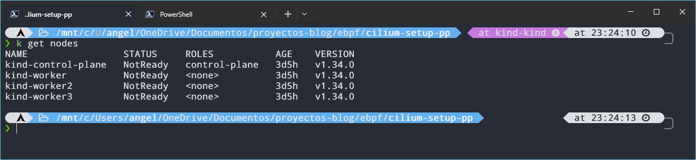

As we can see, the nodes are in `NotReady`, and that's expected: we don't have a CNI yet, so the pods can't have a network. We fix that by installing Cilium:

```bash
cilium install \
  --set encryption.enabled=true \
  --set encryption.type=wireguard \
  --set kubeProxyReplacement=true
```

With this, Cilium replaces `kube-proxy`, as mentioned earlier, and also enables WireGuard encryption for traffic between pods on different nodes. We could also set `encryption.nodeEncryption=true` to extend encryption to node-to-node, pod-to-node, and node-to-pod traffic, rather than just traffic between Cilium-managed pods. However, this feature is in beta.

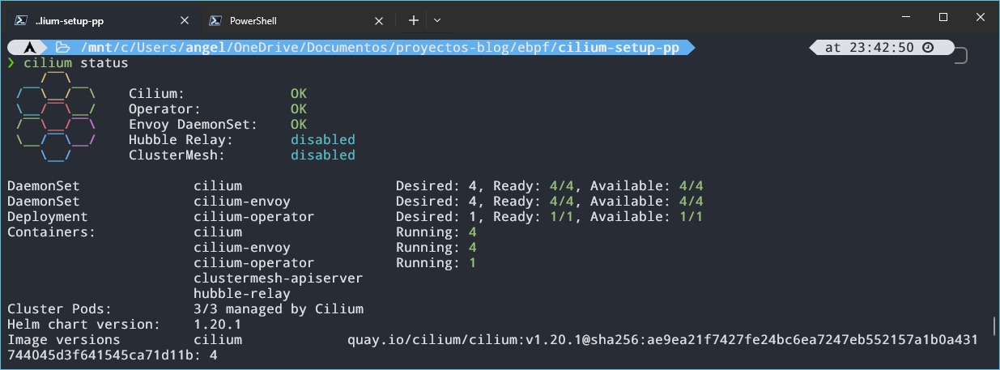

We wait a few seconds and check with `cilium status` that everything is ready. If it is, the nodes should switch to `Ready`.

In the image we can see 4 Envoys running, one per node (three workers + control plane), and also that Hubble Relay and ClusterMesh are disabled. ClusterMesh is used to connect several clusters, so we don't need it for now. Hubble Relay is the piece that gathers the flows that Hubble sees on each node so they can be queried from a single place, so let's enable it:

```bash
cilium hubble enable --ui
```

This enables Hubble Relay together with the UI (the web interface). We run `cilium status` again and we should see them as `OK`. We will go over Hubble in more detail in the [observability](#observability) section, but while we're at it, let's enable the metrics of the Cilium agent and the operator:

```bash
cilium upgrade --version 1.20.3 \
  --set prometheus.enabled=true \
  --set operator.prometheus.enabled=true
kubectl -n kube-system rollout restart daemonset/cilium
```

> We could also have added this to the `cilium install` at the beginning and saved ourselves the upgrade. Without `--version`, `cilium upgrade` would use the CLI's default version, which may not match the one installed in the cluster.

The first command enables the `/metrics` endpoint of the agent and the operator in a format Prometheus can read, and the second restarts the Cilium pods so the change takes effect. These are Cilium's metrics. Hubble's (flows, DNS, drops...) are enabled separately with `hubble.metrics.enabled`, and we will configure them later.

Now it's the turn of the `Gateway API`, the successor of Ingress, which works at L4/L7. We will use it to have a single entry point with HTTPS. First we need to check which version of Cilium we have and look in the documentation for the Gateway API version it requires:

```plaintext
https://docs.cilium.io/en/v1.20/network/servicemesh/gateway-api/gateway-api/
```

Change the version in the URL for the one you have. In my case they ask for `v1.6.1`, so I install the CRDs with:

```bash
kubectl apply -f https://github.com/kubernetes-sigs/gateway-api/releases/download/v1.6.1/standard-install.yaml
```

With the CRDs installed, we have to modify the Helm values. Since we installed Cilium with its CLI, it's likely that we don't have the Cilium repo added to Helm:

```bash
helm repo add cilium https://helm.cilium.io/
helm repo update
```

And now we enable the Gateway API:

```bash
helm upgrade cilium cilium/cilium \
  -n kube-system \
  --version 1.20.3 \
  --reuse-values \
  --set gatewayAPI.enabled=true
```

The agents and the operator only detect the CRDs when they start, so we restart them so they see them:

```bash
kubectl -n kube-system rollout restart deploy/cilium-operator
kubectl -n kube-system rollout restart ds/cilium
```

We check that the `GatewayClass` is deployed:

```bash
kubectl get gatewayclass
```

To configure HTTPS we create a self-signed certificate (it's a local environment) with its private key, and with the two resulting files we create a Kubernetes secret:

```bash
openssl req -x509 -newkey rsa:2048 -nodes -days 365 \
  -keyout tls.key -out tls.crt \
  -subj "/CN=shop.local" -addext "subjectAltName=DNS:shop.local"

kubectl create secret tls shop-tls --cert=tls.crt --key=tls.key
```

Now we create the `Gateway`, telling it to listen on port `443`, the protocol and the secret we just created:

```yaml
apiVersion: gateway.networking.k8s.io/v1
kind: Gateway
metadata:
  name: shop-gw
  namespace: default
spec:
  gatewayClassName: cilium
  listeners:
    - name: https
      protocol: HTTPS
      port: 443
      hostname: shop.local
      tls:
        mode: Terminate
        certificateRefs:
          - name: shop-tls
```

Finally, we need an `HTTPRoute` so the Gateway knows where to route. Here we will only use one, which sends the traffic to the API microservice, which we will see in the next section. We could also add, for example, a listener on port 80 and, with another `HTTPRoute`, redirect to HTTPS.

```yaml
apiVersion: gateway.networking.k8s.io/v1
kind: HTTPRoute
metadata:
  name: apigw-route
  namespace: default
spec:
  parentRefs:
    - name: shop-gw
      sectionName: https
  hostnames:
    - shop.local
  rules:
    - matches:
        - path:
            type: PathPrefix
            value: /api/v1
      backendRefs:
        - name: apigw-svc
          port: 9090
```

## Microservices: REST vs gRPC

As we mentioned before, we are going to reuse the microservices from the last post on the blog. A quick recap, in case you haven't read it: we have 3 microservices, an API gateway (`apigw`), an orders service (`orders`) and a products service (`products`), as you can see in the architecture diagram. The user makes requests to the API and it forwards them to the services over HTTP. From `orders` we can create orders (validated with a request to `products`) and list them, and from `products` we can list the available products.

In the original post all of this was protected with OAuth and Keycloak as the IdP. Here I've removed it to keep the focus on the goal of the article, but if you are interested you can find the explanation in this [link](https://azuar4e.github.io/en/posts/micros-sec-istio/).

The other change is that communication between `orders` and `products` is now *gRPC*. As we saw in the concepts, [gRPC](https://www.ibm.com/es-es/think/topics/grpc) uses HTTP/2 as transport and *Protocol Buffers* to define the contracts, so data travels in binary instead of plain text like JSON or XML. This usually translates into better performance and less traffic, especially in internal communication with lots of calls.

The API Gateway will keep talking REST to both `orders` and `products`, so `products` exposes both interfaces at the same time: REST towards the gateway and gRPC for the calls from `orders`. This way we can compare both protocols inside the same architecture.

This is the directory structure:

```plaintext
micros-sample/
├── api/
│   ├── cmd/
│   └── internal/handlers/
├── manifests/
├── order-service/
│   ├── cmd/
│   └── internal/handlers/
├── product-service/
│   ├── cmd/
│   └── internal/handlers/
└── proto/
```

> The `proto` folder is at the same level as `order-service` and `product-service` because both need access to that code.

For the implementation, the first thing is to create a `.proto` file where we define the `products` methods (`proto/product.proto`):

```proto
syntax = "proto3";

package products;

option go_package = "github.com/azuar4e/proto";

service ProductService {
  rpc GetProducts(GetProductsRequest) returns (GetProductsResponse);
  rpc GetProductById(GetProductByIdRequest) returns (GetProductByIdResponse);
}

message Product {
  string id = 1;
  string name = 2;
  int64 price = 3;
}

message GetProductsRequest {
}

message GetProductByIdRequest {
  string id = 1;
}

message GetProductByIdResponse {
  Product pr = 1;
}

message GetProductsResponse {
  repeated Product pr = 1;
}
```

Here we define two RPC methods for the `ProductService` service: one lists the products and the other returns a product by its identifier. The numbers in the `message` fields are not values, but the identifier of each field in the binary encoding, and they shouldn't be changed once the service is in use. `repeated` means the field is a list, like in `GetProductsResponse`, which returns an array of products.

> Pay attention to the `package products` and the service name. When gRPC travels over HTTP/2, every call is a `POST` to the path `/products.ProductService/MethodName`. That is exactly the path we will use in the `CiliumNetworkPolicy` below.

Once the protocol buffer is defined, let's generate the code from it. The first step is to create a Go module so the generated code can be imported both from `orders` (client) and from `products` (server):

```bash
go mod init github.com/azuar4e/proto
```

> Note that we use the same module name as the one defined in `go_package` in the proto.

Now, from the root of the `proto` directory, we run:

```bash
protoc --go_out=. --go_opt=paths=source_relative \
       --go-grpc_out=. --go-grpc_opt=paths=source_relative \
       product.proto
```

This generates the files `product.pb.go` and `product_grpc.pb.go`. The first one contains the messages and everything needed to serialize and deserialize them, and the second one the gRPC service code: the client and server interfaces, among other things.

To use this code, in the `go.mod` of each microservice we need to add `github.com/azuar4e/proto v0.0.0` inside `require` and the line `replace github.com/azuar4e/proto => ../proto`. The `require` declares that the microservice depends on that module, and since it is local and has no published versions, we use `v0.0.0`. The `replace` tells Go where to find it locally: in `../proto`. As an alternative, you could have a repository with the protos and the generated code, publish versions of the module with tags or releases and give the microservices access to that repository.

Now let's look at the gRPC code of `products`:

```go
type server struct {
  pb.UnimplementedProductServiceServer
}

func (s *server) GetProducts(ctx context.Context, in *pb.GetProductsRequest) (*pb.GetProductsResponse, error) {
  res := make([]*pb.Product, len(products))

  for i := range products {
      res[i] = &pb.Product{
          Id:    products[i].Id,
          Name:  products[i].Name,
          Price: products[i].Price,
      }
  }

  return &pb.GetProductsResponse{Pr: res}, nil
}

func (s *server) GetProductById(ctx context.Context, in *pb.GetProductByIdRequest) (*pb.GetProductByIdResponse, error) {
  for i := range products {
      if products[i].Id == in.Id {
          return &pb.GetProductByIdResponse{
              Pr: &pb.Product{
                  Id:    products[i].Id,
                  Name:  products[i].Name,
                  Price: products[i].Price,
              },
          }, nil
      }
  }
  return nil, errors.New("Invalid ID!")
}
```

The `server` type defines the server and embeds the default implementation, `UnimplementedProductServiceServer`, which lets us implement only the methods we want. The rest of the code implements those methods with the messages we defined in the proto. To start the server all we need is:

```go
lis, err := net.Listen("tcp", ":8077")
if err != nil {
  panic(err)
}
s := grpc.NewServer()
pb.RegisterProductServiceServer(s, &server{})
log.Printf("gRPC server listening at %v", lis.Addr())
if err := s.Serve(lis); err != nil {
  log.Fatalf("failed to serve: %v", err)
}
```

> The REST server code goes right before. The only difference is that its `Run()` is launched inside a goroutine so it doesn't block and the gRPC server can start afterwards.

As you can see, we open a port, create and register the server and make it listen. With this we have the server side, so let's move on to the client, which as we said is the `orders` service:

```go
func main() {
    var opts []grpc.DialOption
    opts = append(opts, grpc.WithTransportCredentials(insecure.NewCredentials()))
    conn, err := grpc.NewClient("products-svc:8077", opts...)
    if err != nil {
        log.Fatalf("Failed to connect: %v", err)
    }
    defer conn.Close()

    client := &handlers.OrderHandler{Products: pb.NewProductServiceClient(conn)}

    ...
}
```

Here we create the client without TLS (it's a test environment), pointing to the `products` Service and the port where the server listens. `OrderHandler` is a struct that holds the gRPC client for `products`, so the `orders` handlers can call it. The method that lists the orders stays the same, and in the one that creates them the call to `products` changes:

```go
type OrderHandler struct {
    Products pb.ProductServiceClient
}

func (h *OrderHandler) CreateOrder(c *gin.Context) {
    // Timeout for context
    ctx, cancel := context.WithTimeout(context.Background(), time.Second*15)
    defer cancel()

    ...

    _, err := h.Products.GetProductById(ctx, &pb.GetProductByIdRequest{
        Id: reqOrder.ProductId,
    })

    if err != nil {
        c.JSON(http.StatusBadRequest, gin.H{"error": "invalid body"})
        return
    }

    ...
}
```

That said, let's move on to the deployment in the cluster. The original repo (main branch) contains some manifests that we will need to modify slightly, but first we have to build the images. Each microservice comes with a `Dockerfile`, so for the API gateway we go to its folder and run:

```bash
docker build -t azuar4e/apigw-ecom:v2 .
```

`products` and `orders` use code from the proto, so their `Dockerfile`s have been modified to include that folder. That's why the commands must be run from `micros-sample` (root directory): we need that build context so Docker can see `/proto`.

```bash
docker build -f ./product-service/Dockerfile -t azuar4e/products-svc:v3 .
docker build -f ./order-service/Dockerfile -t azuar4e/orders-svc:v3 .
```

Once the three images are built, we have to load them into kind, because its nodes can't see the images in your local Docker:

```plaintext
❯ docker image ls
REPOSITORY                    TAG         IMAGE ID       CREATED         SIZE
azuar4e/products-svc          v3          326f451685b2   2 minutes ago   39.1MB
azuar4e/orders-svc            v3          fac6ec007bba   4 minutes ago   39.2MB
azuar4e/apigw-ecom            v2          ea4ea2d4aa9f   34 hours ago    61.3MB
```

```bash
kind load docker-image azuar4e/products-svc:v3 azuar4e/orders-svc:v3 azuar4e/apigw-ecom:v2 --name kind
```

> We pass the image names as arguments and, with `--name`, the name of the cluster.

To deploy the microservices we run:

```bash
kubectl apply -f manifests/
```

This deploys the Deployments and Services of the microservices, as well as the Gateway we saw in the previous section and the network policies we will see next.

Before we can make requests we need to set up a couple of things. Until now, the usual thing was to `port-forward` to the API and send requests from Postman or another client, but here things change. The Service that the Gateway creates (`cilium-gateway-shop-gw`) has no selector, so `kubectl port-forward` has no pod to point to, and it is designed that way.

The solution is to build a bridge with `socat`, a container that listens on a port of our machine and forwards the traffic to a node of the cluster. The path looks like this:

```plaintext
client → localhost:8443 → socat container → NODE_IP:NODEPORT → Gateway
```

To set it up we need two pieces of data: the port of the Gateway Service and the IP of a node.

```bash
kubectl get svc cilium-gateway-shop-gw
kubectl get nodes -o wide
```

> In the `PORT(S)` column of the first command you will see something like `443:30487/TCP`, and the number on the right (`30487`) is the one we care about. The node IP is in the `INTERNAL-IP` column, and any node's IP works.

Now we launch the container:

```bash
docker run -d --rm --name gw-fwd --network kind -p 8443:8443 alpine/socat \
  tcp-listen:8443,fork,reuseaddr tcp-connect:172.18.0.5:30487
```

> Change the IP and the port for your own values. We connect it to the `kind` network so it can reach the nodes' IPs, and `8443` can be any other free port on your machine.

Finally, the client needs to know how to resolve `shop.local` (hostname defined in the Gateway manifest), so we add this line to the hosts file:

```plaintext
127.0.0.1 shop.local
```

On Windows it is at `C:\Windows\System32\drivers\etc\hosts` and you have to open it as administrator:

```powershell
notepad C:\Windows\System32\drivers\etc\hosts
```

If you are on native Linux it's the same, but with your own `/etc/hosts`.

With this we can now make requests to `https://shop.local:8443/api/v1/...`. Since the certificate is self-signed, the client will complain, in Postman we disable SSL verification and with `curl` we use `-k`. You can see the result in the following images.

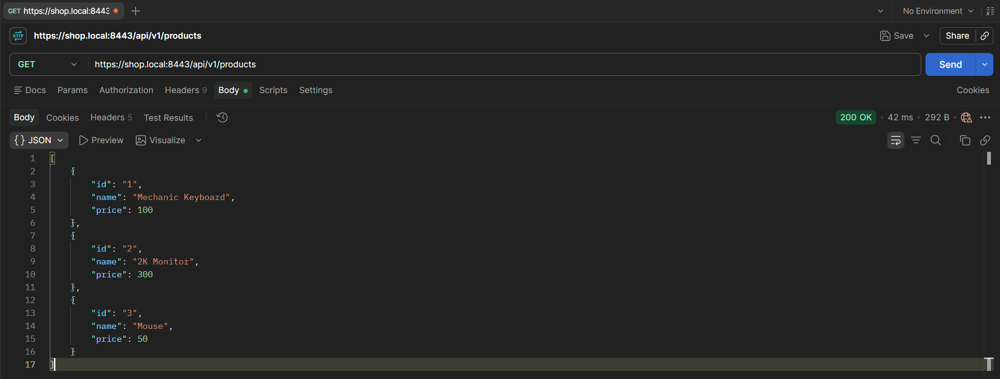

>GET `/products`

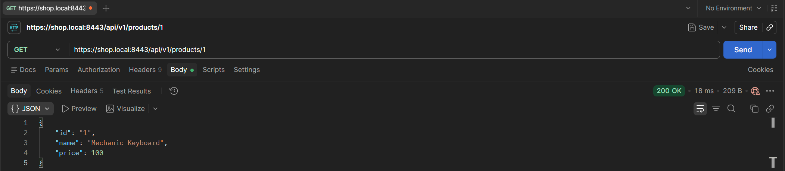

>GET `/products/:id`


>POST `/orders`


>GET `/orders/:id`

## Network Policies L3/4/7

Network policies let us control the incoming (`ingress`) and outgoing (`egress`) traffic of the pods. Cilium extends the Kubernetes ones with its own objects: `CiliumNetworkPolicy`, which acts on a namespace, and `CiliumClusterwideNetworkPolicy`, which acts at cluster level and can also protect the nodes themselves.

Perhaps the most interesting part is L7 filtering. By adding `rules` to a policy, Cilium redirects the traffic to Envoy and filters it by content, for example blocking an HTTP method that is not allowed.

To configure the policies we will use the `cnp.yaml` file. This is a fragment to see how it works:

```yaml
apiVersion: cilium.io/v2
kind: CiliumNetworkPolicy
metadata:
  name: products-policy
  namespace: default
spec:
  endpointSelector:
    matchLabels:
      app: products
  ingress:
    - fromEndpoints:
        - matchLabels:
            app: orders
      toPorts:
        - ports:
            - port: "8077"   # gRPC
              protocol: TCP
          rules:
            http:
              - method: "POST"
                path: "/products.ProductService/GetProductById"
    - fromEndpoints:
        - matchLabels:
            app: apigw
      toPorts:
        - ports:
            - port: "8081"   # REST
              protocol: TCP
          rules:
            http:
              - method: "GET"
                path: "/products"
              - method: "GET"
                path: "/products/[0-9]+"
```

>For the API, which is the entry point, we have to allow traffic from ``ingress`` (the Gateway) using `fromEntities`.

This is the policy for the `products` microservice. From `orders` we allow traffic to port `8077`, where the gRPC server runs, and from `apigw` to `8081`, where the REST server listens.

Then we define what can be done on each port. `orders` only calls `GetProductById`, so it is the only gRPC method we let through (gRPC runs over HTTP/2, so it is filtered as a `POST` to the path `/package.Service/Method`). `apigw` queries both the product list and a specific product, so we allow `GET /products` and `GET /products/{id}`.

The same is repeated in the other two microservices. As soon as a policy selects a pod for `ingress`, everything that is not explicitly allowed is dropped. This way we block unexpected traffic, which reduces the attack surface and limits lateral movement if a pod gets compromised.

To test it, we launch an ephemeral container inside the `orders` pod and from there we call two methods: `GetProductById`, which is allowed in the policy, and `GetProducts`, which is not and therefore should be rejected (`Access denied`), as we can see in the following images.

```bash
kubectl debug -it orders-cb899cffd-6qcbr --image=curlimages/curl --target=orders-svc --profile=general -- sh
```

>You can try it by replacing the pod name with that of one of your own pods. `target` is the name of the container within the pod, as defined in the Deployment manifest.


As you can see, we run a `curl` but for gRPC. Unlike REST, gRPC always uses `POST` as the method, and the URL carries the path of the gRPC method directly: `/products.ProductService/GetProductById`. Since we don't use TLS, there is no negotiation possible, so with `--http2-prior-knowledge` we tell `curl` to speak HTTP/2 directly.

```bash
curl -sv --max-time 5 --http2-prior-knowledge -X POST \
  http://products-svc:8077/products.ProductService/GetProductById
```

Careful, this is not a real gRPC client. We don't send the body in gRPC's format, so don't expect to see the products. What matters is the response: in `GetProductById` the request reaches the server and it returns a `415` since the content type is not supported, and in `GetProducts` the policy cuts it with a `403`.

We can also see this with Hubble, which shows us the requests rejected by the policy (later on we will explain how the tool works).


Now we try the opposite: a `curl` to `products` from a temporary pod that no rule gives access to. Here there is no rejection response as before, because Cilium drops the packets and `curl` keeps waiting until the timeout hits:

```bash
kubectl run tmp --rm -it --image=curlimages/curl --restart=Never -- \
  curl -sv --max-time 5 http://products-svc:8081/products
```

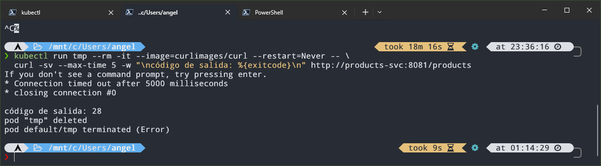

Notice the difference. When the policy denies at L7 level we get a response (`Access denied`), whereas when the source is not authorized at all (L3/L4) the packets are dropped and we get nothing, just the timeout (`curl` exits with code `28`).

## eBPF Agents

As we said, Cilium relies on eBPF (*extended Berkeley Packet Filter*), but eBPF is not just a Cilium thing, we can also write our own programs. An eBPF program usually has two parts:

- **Kernel space:** the program that runs inside the kernel. It defines the function, the hook it attaches to and the data structures (*maps*). It is usually written in C (restricted) and compiled to eBPF *bytecode*, although it can also be done in Rust. Before loading it, the verifier we saw earlier checks that it is safe.
- **User space:** a normal process that loads the program into the kernel and reads or writes the maps to retrieve the information and process it. Here there is more freedom of language (Go, C, Rust, Python...).

For our example we will write the kernel space in C and the user space in Go, with the `cilium/ebpf` library. As you may remember, we are going to create two agents: the first generates metrics from the latency of TCP connections, and the second blocks commands in certain pods. They are two sides of the same coin: observability and security.

### Metrics agent: TCP connection latency

For this agent we use the `sock:inet_sock_set_state` tracepoint, which fires every time the state of a TCP socket changes. We measure, from the client side, the time between sending the `SYN` (`SYN_SENT`) and completing the handshake (`ESTABLISHED`).

> A tracepoint is an instrumentation point that kernel developers have explicitly left in their code, and it tends to be more stable across versions than hooking internal functions.

In kernel space we use three structures:

- An **LRU hash** (*least recently used*) to temporarily store the timestamp of the start of each connection. If it fills up, it discards the least recently used entries, so it doesn't grow without control.
- A **per-CPU array**, which keeps an independent copy per CPU and avoids locking when incrementing. It holds three counters of lost events, each one for a different reason.
- A **ring buffer**, through which we send the events with all the information needed to generate the logs and the metrics to user space.

We get the timestamps with `bpf_ktime_get_ns()`, which returns the nanoseconds elapsed since the system booted.

```c
struct {
    __uint(type, BPF_MAP_TYPE_LRU_HASH);
    __uint(max_entries, 16384);
    __type(key, __u64);   // socket mem addr
    __type(value, __u64); // timestamp
} connections SEC(".maps");

// ring buffer to send the info for the logs
struct {
    __uint(type, BPF_MAP_TYPE_RINGBUF);
    __uint(max_entries, 1 << 24);
} events SEC(".maps");

// per-CPU array for lost events
struct {
    __uint(type, BPF_MAP_TYPE_PERCPU_ARRAY);
    __uint(max_entries, ERRORS_COUNT);
    __type(key, __u32);
    __type(value, __u64);
} lost_events SEC(".maps");

SEC("tracepoint/sock/inet_sock_set_state")
int handle_tcp_state(struct trace_event_raw_inet_sock_set_state *ctx) {

    if (ctx->protocol != IPPROTO_TCP || ctx->family != AF_INET)
        return 0;

    __u64 skaddr = (__u64)ctx->skaddr;
    __u32 key;
    __u64 *val;

    if (ctx->newstate == TCP_SYN_SENT) {
        __u64 ts = bpf_ktime_get_ns();
        bpf_map_update_elem(&connections, &skaddr, &ts, BPF_ANY);

    } else if (ctx->newstate == TCP_ESTABLISHED && ctx->oldstate == TCP_SYN_SENT) {
        __u64 *ts = bpf_map_lookup_elem(&connections, &skaddr);

        if (!ts) {
            bpf_map_delete_elem(&connections, &skaddr);

            key = MISSING_TIMESTAMP;
            val = bpf_map_lookup_elem(&lost_events, &key);
            if (val)
                (*val)++;

            return 0;
        }

        struct tcp_event *ev = bpf_ringbuf_reserve(&events, sizeof(*ev), 0);

        if (!ev) {
            bpf_map_delete_elem(&connections, &skaddr);

            key = RINGBUF_FULL;
            val = bpf_map_lookup_elem(&lost_events, &key);
            if (val)
                (*val)++;

            return 0;
        }

        ev->latency_ns = bpf_ktime_get_ns() - (*ts);
        bpf_map_delete_elem(&connections, &skaddr);
        ev->src_port = ctx->sport;
        ev->dst_port = ctx->dport;
        __builtin_memcpy(ev->saddr, ctx->saddr, 4);
        __builtin_memcpy(ev->daddr, ctx->daddr, 4);
        bpf_ringbuf_submit(ev, 0);

    } else if (ctx->newstate == TCP_CLOSE && ctx->oldstate == TCP_SYN_SENT) {
        bpf_map_delete_elem(&connections, &skaddr);

        key = TCP_FAILED;
        val = bpf_map_lookup_elem(&lost_events, &key);

        if (val)
            (*val)++;
    }

    return 0;
}
```

The logic is as follows: on `SYN_SENT` we store the timestamp, and when we reach `ESTABLISHED` we retrieve it, compute the difference and send the event through the ring buffer. We only handle IPv4 (`AF_INET`).

The three counters of the per-CPU array cover these cases:

- **`MISSING_TIMESTAMP`:** the connection is established but we can't find its timestamp (for example, because the entry was evicted from the LRU). It's an internal problem of the agent.
- **`RINGBUF_FULL`:** there is no room in the ring buffer for the event. Also internal.
- **`TCP_FAILED`:** the socket goes from `SYN_SENT` to `CLOSE`, that is, the connection attempt has failed (refused, timeout...).

For the *user space* we use **`bpf2go`**, a `cilium/ebpf` tool that compiles our C code to eBPF bytecode using Clang and generates the Go files needed to load the programs and maps from Go.

To automate this process, we create a `gen.go` file containing a `//go:generate` directive, where we indicate the compilation target and the C file we want to compile. Once the file is defined, we run `go generate .` from the package directory:

```go
package main

//go:generate go tool bpf2go -target bpfel bpf ../../bpf/metrics.bpf.c
```

> Here we indicate the compilation target (`bpfel`, which specifies *little-endian* BPF bytecode), the base name of the generated files (`bpf`) and the C file we want to compile.

In `main.go` we define a histogram with buckets adjusted to the latencies we observe, and a custom *collector* that reads the values from the per-CPU array and sums the total across all CPUs. In `main` we attach the program to the tracepoint, launch a goroutine with an infinite loop that reads the events from the ring buffer, records the latency in the histogram and generates a log, and finally we expose `/metrics` on port `2112` (the one used by the examples of the Prometheus library for Go).

> The buckets in the code are already the adjusted ones, which I explain after the tests.

```go
...

func newMetrics(reg prometheus.Registerer, lost *ebpf.Map) *metrics {
  m := &metrics{
    latencyHistogram: promauto.With(reg).NewHistogram(prometheus.HistogramOpts{
      Name: "ebpf_tcp_connection_duration",
      Help: "The latency of TCP connection establishment.",
      Buckets: []float64{
        0.00002, 0.00004, 0.00008, 0.00016, 0.00032, 0.00064,
        0.0015, 0.005, 0.025,
        0.25, 1, 3,
      },
    }),
  }
  reg.MustRegister(newLostEventsCollector(lost))
  return m
}

...

func (lec *lostEventsCollector) Collect(ch chan<- prometheus.Metric) {
  for i, reason := range lostReasons {
    var perCPU []uint64
    if err := lec.m.Lookup(uint32(i), &perCPU); err != nil {
      log.Printf("reading %s counter: %v", reason, err)
      continue
    }

    var total uint64
    for _, v := range perCPU {
      total += v
    }

    ch <- prometheus.MustNewConstMetric(
      lec.desc, prometheus.CounterValue, float64(total), reason,
    )
  }
}

func main() {

  ...

  tp, err := link.Tracepoint("sock", "inet_sock_set_state", objs.HandleTcpState, nil)
  if err != nil {
    log.Fatalf("opening tracepoint: %s", err)
  }
  defer tp.Close()

  ...

  go func() {
    var event TCPEvent

    for {
      record, err := rd.Read()
      if err != nil {
        if errors.Is(err, ringbuf.ErrClosed) {
          log.Println("Received signal, exiting..")
          return
        }
        log.Printf("reading from reader: %s", err)
        continue
      }

      if err := binary.Read(bytes.NewBuffer(record.RawSample), binary.LittleEndian, &event); err != nil {
        log.Printf("parsing ringbuf event: %s", err)
        continue
      }

      srcIP := net.IP(event.Saddr[:])
      dstIP := net.IP(event.Daddr[:])

      log.Printf("TCP %s:%d -> %s:%d | latency=%d ns",
        srcIP, event.SrcPort, dstIP, event.DstPort, event.LatencyNs)

      m.latencyHistogram.Observe(float64(event.LatencyNs) / 1e9)
    }
  }()

  http.Handle("/metrics", promhttp.HandlerFor(reg, promhttp.HandlerOpts{}))
  http.ListenAndServe(":2112", nil)
}
```

#### Testing it locally

To test it locally before creating the DaemonSet, we generate, build and run it (with `sudo`, because loading eBPF programs requires privileges):

```bash
go generate ./cmd/metrics && go build -o metrics-agent ./cmd/metrics && sudo ./metrics-agent
```

With the program running, in another terminal we check that it has been loaded:

```bash
sudo bpftool prog list | grep -i handle_tcp_state
```

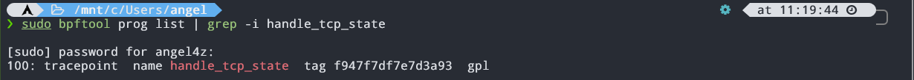

In the agent's terminal the logs with the information we send through the ring buffer should appear:

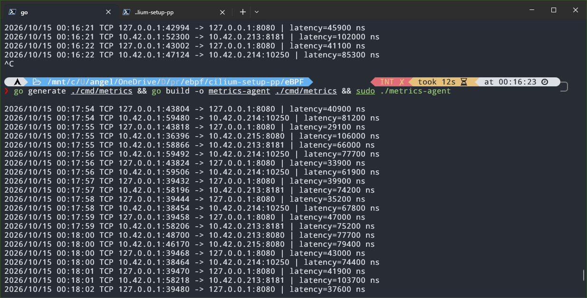

And to see the metrics we run a `curl` against `/metrics` and look for the name of the histogram and the collector:


Of the 633 connections that had happened up to that point, 612 were resolved in less than 100µs. With the default buckets almost all of them fell in the first one, so we adjusted them to gain detail, which is where the values in the code above come from.

### Security agent: blocking commands with BPF LSM

The second agent works differently, instead of observing, it **acts**. For that we use **BPF LSM**. LSM (*Linux Security Modules*) is the kernel framework where SELinux or AppArmor attach to the security *hooks* scattered across the code, and BPF LSM lets us attach eBPF programs there. Each hook fires when a process does something sensitive, and the program decides whether to allow it (returning `0`) or deny it (returning a negative error, like `-EPERM`).

We will use `bprm_check_security`, which runs during `execve`, right before the kernel launches the new binary, and lets us veto the execution.

> An LSM program runs for all the processes on the host (WSL, Docker, kind...). That's why we only block the binaries that are in the block list and whose execution comes from a watched cgroup. For everything else, we return `0` and nothing happens.

Before moving on to the implementation, we need to check whether `bpf` is active as an LSM in the kernel. In my case it was compiled in but not active. We can check it with:

```bash
cat /sys/kernel/security/lsm
cat /proc/cmdline
```

The first one shows the active LSMs (if `bpf` is not at the end of the list, it's no good to us, since it is the one that allows running the programs we are creating) and the second one the kernel boot parameters. If the first file doesn't exist, we have to mount `securityfs` first and check the LSM list again:

```bash
sudo mount -t securityfs securityfs /sys/kernel/security
```

Since we didn't have `bpf` active, we modify (or create) the file `%UserProfile%\.wslconfig`, adding:

```ini
[wsl2]
kernelCommandLine = lsm=landlock,yama,safesetid,selinux,bpf
```

> Careful: `lsm=` replaces the kernel's default list, it doesn't add to it. I used that one because it's the one that came out of `cat /sys/kernel/security/lsm`, but yours may be different: copy the one you get and add `bpf` at the end.

For the change to take effect, we restart WSL from PowerShell:

```powershell
wsl --shutdown
```

And when we open it again, we check that the LSM list ends in `bpf`.

Back to our agent, we use two maps to filter: one with the paths of the binaries we want to block and another with the cgroups we watch. A cgroup is a Linux mechanism that groups processes to limit and account for their resources, and it's what containers use. The runtime creates one per container, so the cgroup ID lets us identify which pod a process comes from. Finally, just like in the metrics agent, we use a ring buffer to send to user space who ran what.

```c
struct {
    __uint(type, BPF_MAP_TYPE_HASH);
    __uint(max_entries, 16384);
    __type(key, __u8[64]); // binary path
    __type(value, __u8);
} blocked_paths SEC(".maps");

struct {
    __uint(type, BPF_MAP_TYPE_HASH);
    __uint(max_entries, 16384);
    __type(key, __u64); // cgroup id
    __type(value, __u8);
} watched_cgroups SEC(".maps");

struct {
    __uint(type, BPF_MAP_TYPE_RINGBUF);
    __uint(max_entries, 1 << 24);
} events SEC(".maps");

SEC("lsm/bprm_check_security")
int BPF_PROG(audit_exec, struct linux_binprm *bprm) {
    __u64 cgi = bpf_get_current_cgroup_id();

    if (!bpf_map_lookup_elem(&watched_cgroups, &cgi))
        return 0;

    __u8 key[64] = {};
    bpf_probe_read_kernel_str(key, sizeof(key), bprm->filename);

    if (!bpf_map_lookup_elem(&blocked_paths, &key))
        return 0;

    struct event *ev = bpf_ringbuf_reserve(&events, sizeof(*ev), 0);

    if (ev) {
        ev->timestamp_ns = bpf_ktime_get_ns();
        ev->pid = bpf_get_current_pid_tgid() >> 32;
        ev->cgroup_id = cgi;
        __builtin_memcpy(ev->path, key, sizeof(key));
        bpf_get_current_comm(&ev->comm, sizeof(ev->comm));
        bpf_ringbuf_submit(ev, 0);
    }

    return -EPERM;
}
```

> If we return `-EPERM`, `execve` fails with `Operation not permitted`.

A couple of details about the code. The key of the paths map is a 64-byte array, which is why we initialize `key` to zeros: the map compares all 64 bytes, and this way whatever is left after the path doesn't introduce garbage. Also, the comparison is **textual**, so `/bin/cat` and `/usr/bin/cat` are two different entries, and we will see it in the tests.

On the user space side, just like in the metrics agent, we expose `/metrics` on port `2112` and read the ring buffer in a goroutine. The only metric is a counter with the blocked executions. Since the agent runs inside the cluster (in a DaemonSet), we configure the Kubernetes client with `InClusterConfig()`. I've left the commands to block in a variable, although they could be passed through environment variables or a ConfigMap.

To decide which cgroups to watch we use two helper functions:

- **`findCgroupID`**: receives the container ID, looks under `/sys/fs/cgroup` for the directory of its cgroup and returns its inode, which matches the ID the kernel sees.
- **`syncCgroups`**: lists the pods with the label `ebpf-sec=enforce` (which we add to the microservices' Deployments for testing), extracts the ID of each container, calls `findCgroupID` and, if it finds it, inserts it into the eBPF map.

>Just like in the metrics agent, we use a `gen.go` to generate the Go code with which we load the program and its maps.

```go
func newMetrics(reg prometheus.Registerer) *metrics {
  m := &metrics{
    execsCounter: promauto.With(reg).NewCounter(prometheus.CounterOpts{
      Name: "ebpf_blocked_execs_total",
      Help: "Total number of command executions blocked by the BPF LSM program.",
    }),
  }
  return m
}

func syncCgroups(ctx context.Context, cs kubernetes.Interface, m *ebpf.Map) error {
  pods, err := cs.CoreV1().Pods("").List(ctx, metav1.ListOptions{
    LabelSelector: "ebpf-sec=enforce",
  })
  if err != nil {
    return err
  }
  for _, pod := range pods.Items {
    for _, c := range pod.Status.ContainerStatuses {
      _, id, ok := strings.Cut(c.ContainerID, "://")
      if !ok || id == "" {
        continue
      }
      cgID, err := findCgroupID(id)
      if err != nil {
        log.Printf("%s/%s: %v", pod.Namespace, pod.Name, err)
        continue
      }
      if err := m.Put(cgID, uint8(1)); err != nil {
        return err
      }
      log.Printf("vigilando %s/%s cgroup=%d", pod.Namespace, pod.Name, cgID)
    }
  }
  return nil
}

func findCgroupID(containerID string) (uint64, error) {
  root := "/sys/fs/cgroup"

  var cgroupID uint64
  found := false

  err := filepath.WalkDir(root,
    func(path string, d os.DirEntry, err error) error {
      if err != nil {
        return nil
      }
      if !d.IsDir() || !strings.Contains(path, containerID) {
        return nil
      }

      var stat unix.Stat_t
      if err := unix.Stat(path, &stat); err != nil {
        return nil
      }

      cgroupID = stat.Ino
      found = true
      return filepath.SkipAll
    })

  if err != nil {
    return 0, err
  }
  if !found {
    return 0, fmt.Errorf("cgroup not found for container %s", containerID)
  }

  return cgroupID, nil
}

...

func main() {
  ctx := context.Background()

  cfg, err := rest.InClusterConfig()
  if err != nil {
    log.Fatalf("loading in-cluster config: %v", err)
  }
  cs, err := kubernetes.NewForConfig(cfg)
  if err != nil {
    log.Fatalf("creating kubernetes client: %v", err)
  }

  ...

  // insert into the map the paths of the commands we want to block
  var paths = []string{"/bin/curl", "/bin/cat"}

  for _, p := range paths {
    var key [64]byte
    copy(key[:], p)
    if err := objs.BlockedPaths.Put(&key, uint8(1)); err != nil {
      log.Fatalf("copying command to blocked_paths ebpf map: %v", err)
    }
  }

  if err := syncCgroups(ctx, cs, objs.WatchedCgroups); err != nil {
    log.Println(err)
  }

  lsm, err := link.AttachLSM(link.LSMOptions{
    Program: objs.AuditExec,
  })
  if err != nil {
    log.Fatalf("opening lsm hook: %s", err)
  }
  defer lsm.Close()

  // pods come and go, so we resync every 10 seconds
  go func() {
    for {
      time.Sleep(10 * time.Second)
      if err := syncCgroups(ctx, cs, objs.WatchedCgroups); err != nil {
        log.Println(err)
      }
    }
  }()

  ...

  http.Handle("/metrics", promhttp.HandlerFor(reg, promhttp.HandlerOpts{}))
  http.ListenAndServe(":2112", nil)
}
```

#### Testing it locally

To test it outside the cluster we make a few adjustments; in `main` we comment out everything related to the Kubernetes client (since the agent isn't running as a DaemonSet) and add a flag to pass the path of a test cgroup, whose ID we insert into the kernel map. It could be hardcoded, but this way is more convenient.

```go
cgroupPath := flag.String("cgroup", "", "path of a cgroup to watch (testing)")
flag.Parse()

if *cgroupPath != "" {
  var st unix.Stat_t
  if err := unix.Stat(*cgroupPath, &st); err != nil {
    log.Fatal(err)
  }
  if err := objs.WatchedCgroups.Put(uint64(st.Ino), uint8(1)); err != nil {
    log.Fatal(err)
  }
  log.Printf("vigilando cgroup %d (%s)", st.Ino, *cgroupPath)
}
```

The commands to block change. On the local machine the binaries are in `/usr/bin`, while in the microservices' images they are in `/bin`. As an example we block `curl` and `cat`:

```go
var paths = []string{"/usr/bin/curl", "/usr/bin/cat"}
```

> We can see the path of a command with `type <command>` in the test terminal.

Now we create the cgroup and launch a shell inside it, from which we will run the test commands:

```bash
sudo mkdir /sys/fs/cgroup/prueba
sudo sh -c 'echo $$ > /sys/fs/cgroup/prueba/cgroup.procs; exec bash'
```

> This creates the `prueba` (test) cgroup, puts the shell's PID in its `cgroup.procs` (so the shell becomes a member of the cgroup) and replaces it with `bash`. Everything we run from there inherits the cgroup.

In another terminal we build and launch the agent pointing to that cgroup:

```bash
sudo ./security-agent -cgroup /sys/fs/cgroup/prueba
```

If we now run `cat` or `curl` from the cgroup's shell, they are denied:


Meanwhile, the agent logs the watched cgroup and the blocked commands:


And if we check `/metrics` in another terminal, we will see the counter of blocked executions:

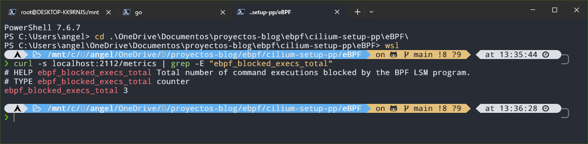

When we are done, we exit the test shell and delete the cgroup with `sudo rmdir /sys/fs/cgroup/prueba`.

### Deploying the agents in the cluster

Just like with the microservices, we build the images and load them into kind:

```bash
docker build -f cmd/metrics/Dockerfile -t azuar4e/ebpf-metrics:v1 .
docker build -f cmd/security/Dockerfile -t azuar4e/ebpf-sec:v1 .
kind load docker-image azuar4e/ebpf-sec:v1 azuar4e/ebpf-metrics:v1 --name kind
```

Before building the security agent's image, remember to put back the paths of the microservices' images (`/bin/curl` and `/bin/cat`).

With the images loaded, we deploy the DaemonSets, which create one pod of each agent per node. Since we have three workers, we will have three pods of each:


The security agent also needs permissions to list pods, because otherwise it will use the `default` service account and the cluster will deny the request. That's why we create a `ServiceAccount`, a `ClusterRole` with read permissions on `pods` and a `ClusterRoleBinding` that joins them.

To check that the metrics agent works, the easiest way is to port-forward to one of its pods and `curl` `/metrics`:

```bash
kubectl port-forward pod/ebpf-metrics-hkctj 2112:2112
```


For the security agent we have to add the label `ebpf-sec: enforce` in `spec.template.metadata.labels` of the microservices' Deployments (the labels of the pods that get created), so they are recreated with it. In the logs of each agent pod we see this:

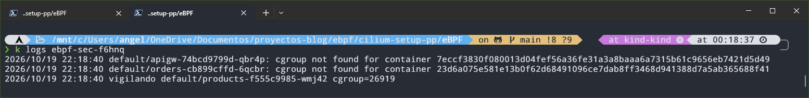

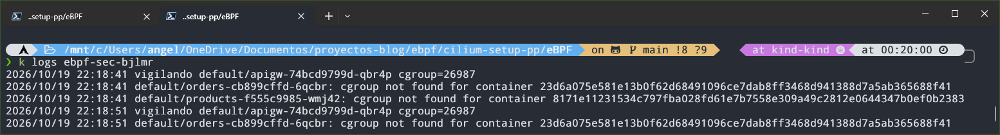


Each pod of the DaemonSet only finds in its `/sys/fs/cgroup` the cgroups of the containers of its own node. Since the microservices each run on a different node (in my case, by decision of the Kubernetes scheduler), each agent pod ends up watching a different microservice.

If we now try to run a blocked command inside one of the microservices, it gets denied:

```bash
kubectl exec -it <pod-micro> -- cat /etc/hostname
```

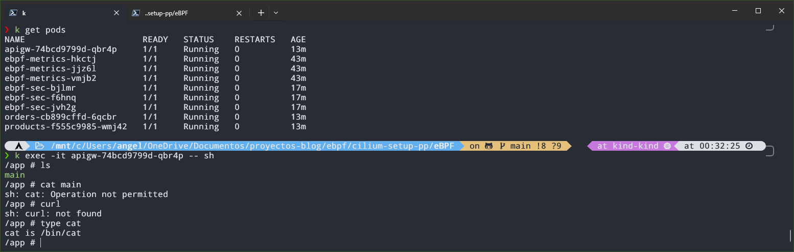

To see the metrics we repeat the previous process with the security agent's pod:

```bash
kubectl port-forward pod/ebpf-sec-bjlmr 2112:2112
```


> Note that I did the port-forward to the pod that watches the `apigw` cgroup, which is where I ran the command. If you look at the metrics of another pod where we haven't run anything, the counter will stay at 0.

## Observability

Earlier we showed how to enable the `/metrics` endpoint so Prometheus can read it, and also how to activate Hubble. Now let's put all the pieces of the puzzle together to complete the observability infrastructure.

The first thing will be to install both Prometheus and Grafana. For that we will use the [community Helm charts](https://artifacthub.io/packages/helm/prometheus-community/kube-prometheus-stack):

```bash
helm repo add prometheus-community https://prometheus-community.github.io/helm-charts
helm repo update
helm install kps prometheus-community/kube-prometheus-stack -n monitoring --create-namespace
```

> With the last command, first we create the `monitoring` namespace, which didn't exist until now, and second, we install the Prometheus stack with the name `kps`.

The Helm chart we just installed contains, among other things, the following:


- **Prometheus**, together with its **operator**, which adds its own objects such as `PodMonitor` or `ServiceMonitor` to tell it what to scrape.
- **Grafana**, which comes already connected to Prometheus and ships with preloaded dashboards through ConfigMaps.
- **Alertmanager**, to manage alerts.
- **`node-exporter`** (one pod per node, as a DaemonSet) and **`kube-state-metrics`**, which export metrics about the nodes and the state of Kubernetes objects, respectively.

For Prometheus to read the metrics of the eBPF agents we created, we have to declare a `PodMonitor`. Together with `ServiceMonitor`, it is a CRD (Custom Resource Definition) added by the Prometheus Operator, included in the Helm chart, and it is used to tell Prometheus which endpoints to scrape. The `ServiceMonitor` discovers targets through a Service, while the `PodMonitor` selects pods directly, which is what we need in our case, since our agents run as DaemonSets and have no Service.

```yaml
apiVersion: monitoring.coreos.com/v1
kind: PodMonitor
metadata:
  name: ebpf-agents
  namespace: monitoring
  labels:
    release: kps
spec:
  namespaceSelector:
    matchNames: [default]
  selector:
    matchExpressions:
      - {key: app, operator: In, values: [ebpf-metrics, ebpf-sec]}
  podMetricsEndpoints:
    - port: metrics
      path: /metrics
```

Since we have two agents, we use `matchExpressions`, although we could also create two `PodMonitor`s and just use `matchLabels`. Also, we deploy the resource in the `monitoring` namespace and make it look in `default` (by default it looks in the namespace where it was deployed), and we have to specify the name of the Helm release with `release: kps`.

Now let's build the charts in Grafana to give shape to the metrics we have generated. To see the Grafana interface we can port-forward to the service and put the URL in the browser. The user is `admin` and, to get the password, we run:

```bash
kubectl get secret -n monitoring kps-grafana -o jsonpath='{.data.admin-password}' | base64 -d
```

Once inside, we can check whether Prometheus is reading the metrics by going to `Explore` and, with the Prometheus data source, searching for the metrics we defined in user space.


> You can also search for the `tcp_lost_events_total` metric and it will show up.

Now let's build the charts with our metrics to get as much detail as possible. For that we go to the Dashboards tab, create a new one and add a panel for each metric.


I have created the following panels:

- **TCP lost connections** (two panels): one with the connections that fail and another with the events that the eBPF agent itself couldn't record (for example, because the timestamp is missing or because the ring buffer is full).
- **TCP connection latency** (two panels): from the Prometheus histogram, a *Time series* with the 50th, 95th and 99th percentiles together with the average, and a *Heatmap* with the values collected by the buckets.
- **Blocked commands**: a counter with the total number of executions denied by the LSM program, which, as you can see, is at zero because we haven't blocked anything yet.

To see it in action, we run a loop inside the `apigw` pod, which carries the watch label. Every `cat` will be denied by the LSM hook:

```bash
kubectl exec -it apigw-74bcd9799d-qbr4p -- sh -c 'for i in $(seq 1 20); do cat /etc/hostname; sleep 1; done'
```

> This runs a 20-iteration loop that launches a `cat` and waits one second, inside the `apigw` pod. Since `cat` is in the blocked commands list, every attempt fails with `Operation not permitted` and the agent counts it.

After a moment (by default, Prometheus scrapes metrics every 15 seconds), we refresh the dashboard and the counter will have gone up:

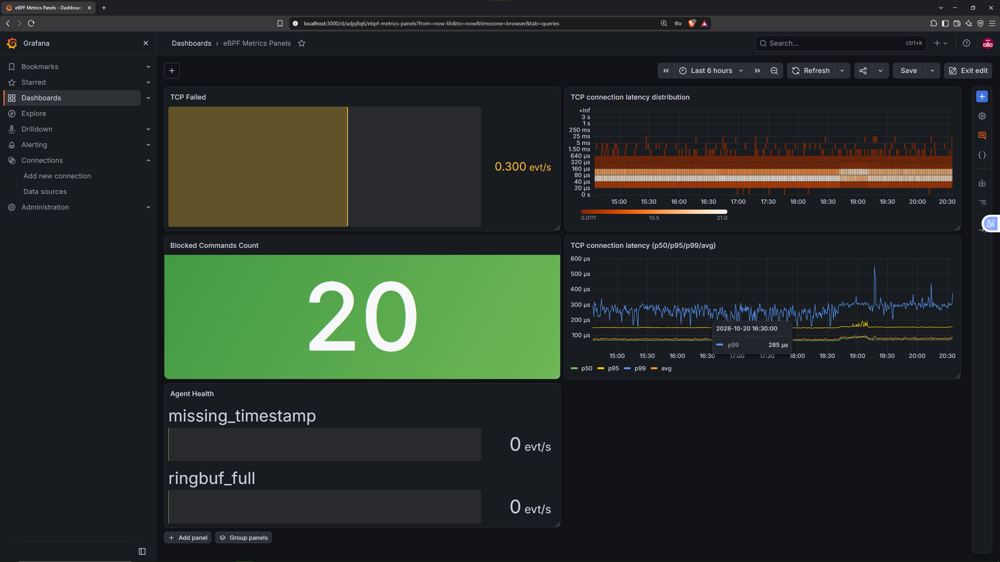

We shouldn't forget about the Hubble and Cilium metrics. To start with Hubble, we port-forward and check the connectivity status with:

```bash
cilium hubble port-forward &
hubble status
```

For Prometheus to see the Hubble metrics (and the Cilium ones we enabled earlier in the article) we have to do two things: indicate which Hubble metrics we want to export and create a `ServiceMonitor` for each component. We need one for Hubble, another for the Cilium agent and another for the operator, and the Cilium chart itself generates them with the following parameters:

```bash
helm upgrade cilium cilium/cilium -n kube-system --reuse-values \
  --set hubble.metrics.enabled="{dns,drop,tcp,flow,http}" \
  --set hubble.metrics.serviceMonitor.enabled=true \
  --set hubble.metrics.serviceMonitor.labels.release=kps \
  --set prometheus.serviceMonitor.enabled=true \
  --set prometheus.serviceMonitor.labels.release=kps \
  --set operator.prometheus.serviceMonitor.enabled=true \
  --set operator.prometheus.serviceMonitor.labels.release=kps
```

> The `release=kps` label is the one the chart's Prometheus looks for to accept a monitor, and it must match the name of our Helm release. Without it, Prometheus ignores it.

Before looking at the metrics in Grafana, let's use `hubble observe`, which shows in the terminal the individual events (flows) that Hubble holds in memory. This way you can see the difference with the metrics we generated with eBPF.

Taking advantage of the `CiliumNetworkPolicy`s we defined in the [network policies](#network-policies-l347) section, we will launch a `curl` to `products` from a temporary pod that no rule authorizes. This should drop the traffic and we will be able to see it in Hubble.

In one terminal we leave Hubble listening, filtering only the dropped packets and removing the noise of ICMP traffic:

```bash
hubble observe --verdict DROPPED --not --protocol icmp -f
```

And in another we launch the request:

```bash
kubectl run curl-test --rm -it --image=curlimages/curl --restart=Never -- curl -sv --max-time 3 http://10.96.73.245:8081
```

> This runs a `curl` to `products` from a temporary pod. Since no rule allows this traffic, Cilium drops the packets and `curl` ends with a timeout. I used the `ClusterIP` of the `products` service, which will be different in your cluster.

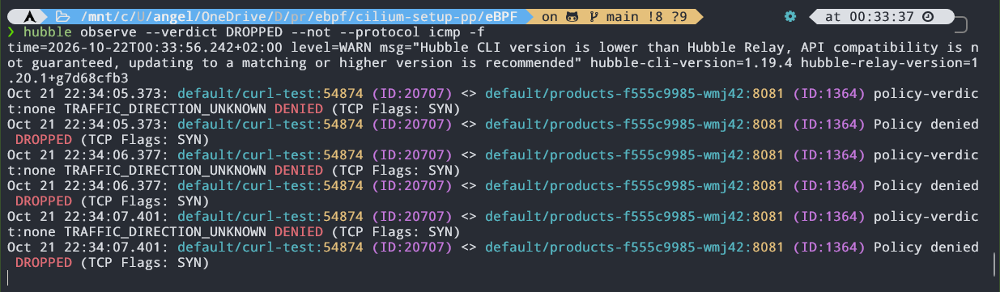

In the output we see the source and destination, the Cilium security identity of each one, the verdict (`Policy denied DROPPED`) and the TCP flags. Only the `SYN` appears, the first packet of the handshake, repeated on every retry, because the packet is dropped and never reaches its destination.

Going back to the metrics, in Grafana we can go to `Explore` to check whether Prometheus is indeed reading the metrics correctly.


As the screenshots show, both the Hubble and the Cilium metrics appear in the search box. With this we could build a great variety of dashboards, but that deserves a post of its own.

As an example, I built a dashboard with three panels. In the first one we have the packets dropped by Hubble (`hubble_drop_total`); in the second, the processed flows (`hubble_flows_processed_total`), with the forwarded ones in yellow and the dropped ones in green; and in the third, all the errors and warnings from the Cilium agent pods (`cilium_errors_warnings_total`).

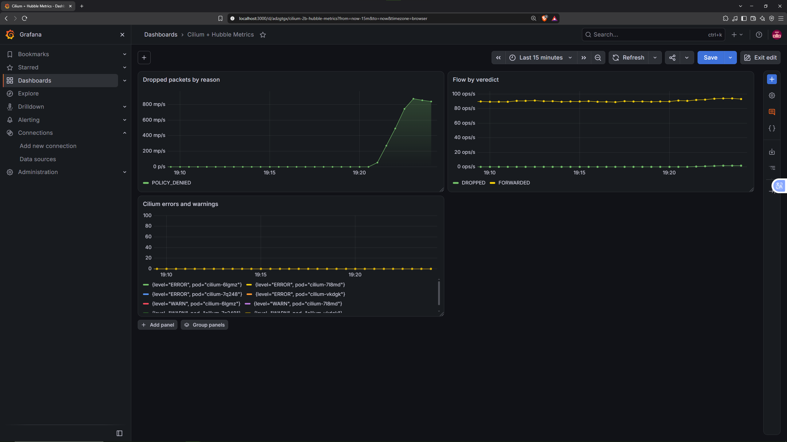

> To generate data in the charts, the previous `curl` was run in a loop.

Collecting these metrics is especially useful to get more visibility and detail about what is happening in our cluster, so we can identify what is going on and act accordingly.

## Additional Notes

Some of you who are more familiar with the topic may already know [Tetragon](https://tetragon.io/), an open-source tool from the Cilium ecosystem focused on observability and runtime security. Using eBPF, it allows us to monitor process activity within the cluster and enforce security policies without having to develop our own agents from scratch.

For example, we could define a `TracingPolicy` to prevent certain pods from executing specific commands, thus covering a large part of our security agent's functionality. The observability agent, however, is another story. Our TCP latency metric requires correlating a socket's transitions between `SYN_SENT` and `ESTABLISHED`, calculating the difference between both timestamps in the kernel, and exporting the results as a Prometheus histogram. This is custom logic that Tetragon does not provide directly through its policies.

If you were already familiar with the tool, you may have wondered why we didn't use it. Tetragon is particularly interesting for enforcing security policies in Kubernetes without having to develop the entire instrumentation infrastructure from scratch. In the context of this article, however, I thought it would be more educational to implement the agents manually to understand how eBPF programs work under the hood and illustrate some of their possibilities. Furthermore, doing so allows us to adapt the logic exactly to our needs, without limiting ourselves to the functionality offered by an existing tool.

That said, we have to be realistic; the security agent is a demo. It blocks executions based on the text of the executable's path and does not provide context about processes. Tetragon offers a much more complete solution in that regard, but developing our own agent has allowed us to directly explore the mechanisms that make these kinds of tools possible.

## Conclusion

That wraps up the article. Remember that you can find all the code used in this post, including the `.yaml` manifests, at the following links:

- Microservices code (`grpc` branch): <https://github.com/azuar4e/micros-sample/tree/grpc>
- eBPF agents code: <https://github.com/azuar4e/ebpf-observability-security>

In essence, we have learned to deploy and configure Cilium so that, besides being the CNI, it also takes care of Service Mesh duties like encryption between nodes with WireGuard, HTTPS with the outside world through Kubernetes' Gateway API and control of the traffic allowed inside the cluster with network policies. We have also compared the differences and advantages between a REST implementation and one based on gRPC.

And, perhaps the most interesting part, we have programmed two eBPF agents, using C for the kernel space code and Go for the user space. The first measures the latency of TCP connection establishment and exposes it through a Prometheus histogram; the second lets us block the execution of certain binaries in the containers we select, also recording the denied attempts as metrics.

To close the circle, we have set up a complete observability stack: Hubble to observe the cluster's events, Prometheus to collect the metrics (those of Hubble, those of the Cilium agent and operator and those of our eBPF agents) and Grafana, using Prometheus as a data source, to shape them into charts and dashboards.

This is just a sample of everything that can be done with Cilium and eBPF, and I hope it has been useful to understand its relevance in modern infrastructures.

Thanks for reading, see you in the next one. Take care! 👋
