# Cilium + EBPF: Observabilidad Y Seguridad en Kubernetes


Construir clústeres robustos y seguros es uno de los principales retos de quienes trabajamos con infraestructura cloud. En entornos basados en Kubernetes, no basta con desplegar los servicios, también necesitamos garantizar que se comuniquen de forma segura y disponer de un sistema de observabilidad fiable que nos permita entender qué ocurre dentro del clúster.

En este artículo veremos cómo configurar Cilium en un entorno **local** para gestionar la red y la seguridad de un clúster de Kubernetes, incluyendo políticas L3/L4/L7 mediante `CiliumNetworkPolicy`, cifrado entre nodos con WireGuard y exposición de servicios mediante Gateway API. Además, mostraremos cómo podemos programar e implementar agentes eBPF dentro del clúster, extendiendo la funcionalidad de Cilium. Por último, implementaremos un sistema de métricas compuesto por Hubble, que se encargará de exportar métricas a Prometheus para visualizarlas con Grafana.

Como caso de uso reutilizamos los microservicios que se encuentran en el [repositorio de GitHub](https://github.com/azuar4e/micros-sample), pero con algunas modificaciones. Para no desviar la atención del objetivo principal del artículo, se ha eliminado todo el código del flujo OAuth 2.0 y se han modificado algunas peticiones para mostrar la diferencia entre una implementación sobre gRPC y otra sobre REST. Todo esto se muestra en la sección de [Microservicios](#microservicios-rest-vs-grpc).

## Conceptos Básicos

Para entender la infraestructura que vamos a montar, primero tenemos que ver un par de conceptos.

### Qué es eBPF

eBPF (*extended Berkeley Packet Filter*) es una tecnología del kernel de Linux que nos permite ejecutar nuestros propios programas dentro del kernel, sin tocar su código fuente ni cargar módulos. Estos programas se asocian a *hooks*, que son puntos concretos de ejecución del kernel: una syscall, un tracepoint, la llegada de un paquete a una interfaz de red... Cuando ocurre ese evento, el kernel dispara nuestro programa.

Antes de ejecutarlo, el kernel lo pasa por el **verificador**, que comprueba que el programa termina, que no accede a memoria que no debe y que no puede tirar el sistema abajo. Por eso eBPF se considera una forma segura de extender el kernel. Además, los programas se compilan a código máquina (JIT), así que van rápido, y pueden comunicarse con el user space a través de **mapas**, que son estructuras de datos compartidas entre ambos lados. Lo veremos en la parte del agente.

¿Qué ganamos con esto? Podemos observar y actuar a muy bajo nivel, con muy poco overhead y sin tener que modificar las aplicaciones ni meter un sidecar en cada pod. Detectamos y solventamos ciertos problemas justo donde ocurren, ahorrando tiempo y recursos.

### Qué es Cilium

Cilium es un proyecto *cloud native* basado en eBPF que aporta redes, seguridad y observabilidad a Kubernetes. En esencia es un **CNI** (Container Network Interface), el componente que se encarga de dar red a los pods, pero hace bastante más que eso.

Por ejemplo, puede sustituir a `kube-proxy`. Este último implementa los Services con reglas de `iptables`, que se evalúan de forma secuencial y se vuelven lentas y difíciles de depurar a medida que crece el clúster. Cilium hace ese trabajo con programas y mapas eBPF, que resuelven el destino con una búsqueda directa en lugar de recorrer una lista de reglas.

Además, sus políticas de red se basan en la identidad de los pods (sus labels) y no en IPs que cambian constantemente, y pueden llegar hasta capa 7. A eso le suma cifrado entre nodos con WireGuard, soporte para la Gateway API y Hubble para ver qué ocurre en la red.

Y como Cilium está hecho con eBPF, tiene todo el sentido del mundo que acabemos programando nuestros propios agentes. De eso va este artículo.

### Otros conceptos

Por otro lado, aunque tienen menos peso en este artículo y es probable que ya conozcáis algunos, también vamos a usar:

- **Prometheus**, que recoge y almacena métricas, y **Grafana**, que nos permite dibujarlas en gráficas y dashboards.
- **Hubble**, una herramienta del proyecto Cilium que muestra los flujos y eventos que ocurren en el clúster. Exportaremos sus métricas para que Prometheus las lea y poder verlas desde Grafana.
- **gRPC** y **REST**, dos formas de construir APIs que compararemos en el artículo, con sus ventajas y desventajas.
  - **gRPC** es un framework de llamadas a procedimientos remotos (RPC), de código abierto y creado inicialmente por Google. Usa HTTP/2 como transporte y Protocol Buffers para describir las interfaces y serializar los datos en binario.
  - **REST** (Transferencia de Estado Representacional) es un estilo de arquitectura, no un protocolo, que aporta fiabilidad, eficiencia y escalabilidad a los sistemas distribuidos. Lo habitual es implementarlo sobre HTTP/1.1 y representar los recursos en JSON o XML, que son formatos de texto plano. Esto los hace más legibles, pero también más pesados que el binario de Protobuf, y por ende, más lentos en su transmisión.

  Más adelante veremos de pasada la diferencia entre ambas implementaciones.

## Descripción General

Explicados estos conceptos, y para ilustrar cómo encajan, os propongo el siguiente diagrama de arquitectura.

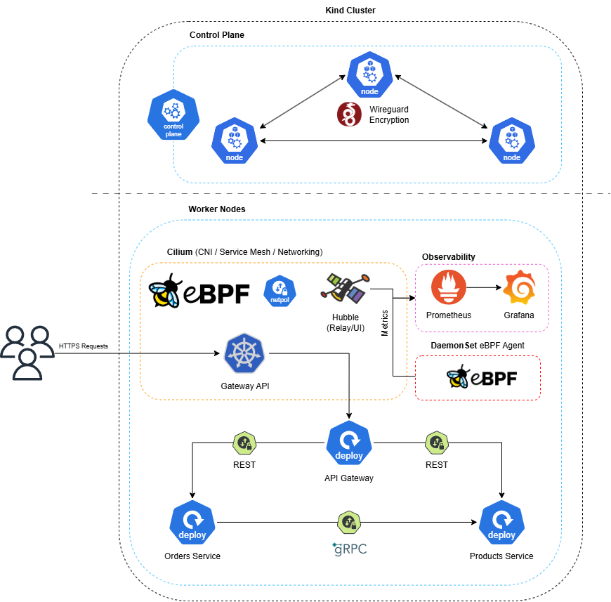

Como veis, tenemos un clúster de kind con 4 nodos: un control plane y 3 workers. Entre nodos aplicamos cifrado transparente: WireGuard cifra el tráfico a nivel de kernel sin que las aplicaciones tengan que enterarse. Dentro de los workers corre una aplicación de 3 microservicios que se comunican mediante REST y gRPC, y cuyo tráfico está restringido con *Network Policies*.

Además, desplegamos dos agentes eBPF como DaemonSet. Uno mide la latencia de establecimiento de las conexiones TCP y la expone como métricas para Prometheus. El otro bloquea los comandos que le indiquemos en los pods que queramos, y también expone métricas.

Por último, Hubble nos da visibilidad de los flujos de red, y tanto sus métricas como las del agente y el operador de Cilium las recoge Prometheus. Grafana se encarga de dibujar todos esos datos en gráficas.

No os preocupéis si se os escapa algún concepto, que lo iremos viendo todo con detenimiento a su debido tiempo.

## Prerrequisitos

Estas son las herramientas usadas para montarlo todo. Las versiones pueden importar, ya que entre versiones pueden cambiar cosas.

- **Entorno:** Windows + WSL2 (Arch). En Linux nativo debería funcionar igual.
- **Kernel** 6.6.87.2-microsoft-standard-WSL2. Ya trae BTF y BPF LSM compilados, pero hay que activar `bpf` en la lista de LSM (lo explico más adelante).
- **Docker Desktop** 4.45.0 (Docker Engine 28.3.3), con la integración de WSL2 activada
- **kind** v0.33.0 y **Kubernetes** v1.34.0
- **kubectl** v1.32.2
- **Helm** v4.3.0
- **Cilium** 1.20.3 (clúster) y **Cilium CLI** v0.20.1
- **Hubble CLI** v1.19.4
- **Go** 1.27.2
- **clang/llvm** 23.1.3, solo si quieres compilar el código eBPF a mano. Con las imágenes de Docker del repo no hace falta.

Tenéis disponible todo el código de esta publicación, incluidos los manifiestos `.yaml`, en los siguientes enlaces:

- Código de los microservicios (rama `grpc`): <https://github.com/azuar4e/micros-sample/tree/grpc>
- Código de los agentes eBPF: <https://github.com/azuar4e/ebpf-observability-security>

Dicho esto, vamos con la implementación.

## Cilium: Instalación y Configuración

Un clúster de Kubernetes necesita un CNI para que los pods tengan red. Sin uno, los nodos se quedan en `NotReady` y los pods no arrancan. kind trae el suyo por defecto, [kindnet](https://kindnet.es/docs/design/cni/), pero en nuestro caso queremos que Cilium se encargue de gestionar la red del clúster, por lo que desactivaremos kindnet durante su creación.

Como ya vimos, Cilium es un CNI construido sobre eBPF, y eso se nota en que las decisiones de red en L3/L4 se resuelven directamente en el kernel, sin pasar por el user space. Pero no se queda ahí, y hay dos cosas que conviene tener claras antes de seguir.

La primera es que Cilium también puede hacer de service mesh, que es la capa de infraestructura que gestiona la comunicación entre servicios. La Mutual Authentication clásica está deprecada desde la 1.20, y la alternativa nueva, mTLS sin sidecars con ztunnel, sigue en beta. Si necesitas un service mesh completo, puedes montar Istio o Linkerd encima de Cilium, pero esto está fuera del alcance de este artículo.

La segunda es que Cilium despliega un Envoy en cada nodo, que es el que aplica las políticas L7 (HTTP y compañía) de las network policies. Lo digo porque mucha gente piensa que un CNI se limita a L2/L3/L4, y no tiene por qué ser así.

Una vez vista la teoría básica, pasemos a la práctica. Lo primero es crear el clúster:

```bash
kind create cluster --config ./kube-config.yaml
```

Esto nos despliega un clúster de kind con tres workers además del control plane. Como vamos a usar Cilium como CNI (sustituyendo a kindnet) y él se encarga de las funciones de `kube-proxy` gracias a eBPF, desactivamos los dos en el `kube-config`:

```yaml
kind: Cluster
apiVersion: kind.x-k8s.io/v1alpha4
nodes:
- role: control-plane
- role: worker
- role: worker
- role: worker
networking:
  disableDefaultCNI: true
  kubeProxyMode: "none"
```


Como vemos, los nodos están en `NotReady`, y es normal: todavía no tenemos CNI, así que los pods no pueden tener red. Lo arreglamos instalando Cilium:

```bash
cilium install \
  --set encryption.enabled=true \
  --set encryption.type=wireguard \
  --set kubeProxyReplacement=true
```

Con esto Cilium sustituye a `kube-proxy`, como comentamos, y además activa el cifrado del tráfico entre pods de distintos nodos usando WireGuard. También podríamos añadir `encryption.nodeEncryption=true`, que cifra adicionalmente el tráfico nodo-a-nodo, pod-a-nodo y nodo-a-pod, no solo el tráfico entre los pods gestionados por Cilium. Sin embargo, esta funcionalidad está en fase beta.


Esperamos unos segundos y comprobamos con `cilium status` que todo está listo. Si es así, los nodos deberían pasar a `Ready`.

En la imagen vemos 4 Envoys corriendo, uno por nodo (tres workers + control plane), y también que Hubble Relay y ClusterMesh están deshabilitados. ClusterMesh sirve para conectar varios clústeres, así que de momento no nos interesa. Hubble Relay es la pieza que junta los flujos que ve Hubble en cada nodo para poder consultarlos desde un único punto, así que vamos a activarlo:

```bash
cilium hubble enable --ui
```

Esto activa Hubble Relay junto con la UI (la interfaz web). Volvemos a lanzar `cilium status` y deberíamos verlos en `OK`. Hubble lo veremos con más detalle en la sección de [observabilidad](#observabilidad), pero ya que estamos, dejamos habilitadas las métricas del agente de Cilium y del operator:

```bash
cilium upgrade --version 1.20.3 \
  --set prometheus.enabled=true \
  --set operator.prometheus.enabled=true
kubectl -n kube-system rollout restart daemonset/cilium
```

> También podríamos haberlo añadido al `cilium install` del principio y así nos ahorrábamos el upgrade. Sin `--version`, `cilium upgrade` usaría la versión por defecto del CLI, que puede no coincidir con la que tenemos instalada en el clúster.

El primer comando habilita el endpoint `/metrics` del agente y del operator en un formato que Prometheus puede leer, y el segundo reinicia los pods de Cilium para que el cambio surta efecto. Estas son las métricas de Cilium. Las de Hubble (flujos, DNS, drops...) se activan por separado con `hubble.metrics.enabled`, y las configuraremos más adelante.

Ahora toca el `Gateway API`, el sucesor de Ingress, que trabaja en L4/L7. Lo vamos a usar para tener un único punto de entrada con HTTPS. Primero tenemos que ver qué versión de Cilium tenemos y consultar en la documentación qué versión de Gateway API necesita:

```plaintext
https://docs.cilium.io/en/v1.20/network/servicemesh/gateway-api/gateway-api/
```

Cambia la versión de la URL por la que tengas tú. En mi caso piden la `v1.6.1`, así que instalo los CRDs con:

```bash
kubectl apply -f https://github.com/kubernetes-sigs/gateway-api/releases/download/v1.6.1/standard-install.yaml
```

Con los CRDs instalados, hay que modificar los values de Helm. Como hemos instalado Cilium con su CLI, es probable que no tengamos añadido el repo de Cilium en Helm:

```bash
helm repo add cilium https://helm.cilium.io/
helm repo update
```

Y ahora activamos el Gateway API:

```bash
helm upgrade cilium cilium/cilium \
  -n kube-system \
  --version 1.20.3 \
  --reuse-values \
  --set gatewayAPI.enabled=true
```

Los agentes y el operator solo detectan los CRDs al arrancar, así que los reiniciamos para que los vean:

```bash
kubectl -n kube-system rollout restart deploy/cilium-operator
kubectl -n kube-system rollout restart ds/cilium
```

Comprobamos que la `GatewayClass` está desplegada:

```bash
kubectl get gatewayclass
```

Para configurar HTTPS creamos un certificado autofirmado (es un entorno local) con su clave privada, y con los dos archivos resultantes creamos un secret de Kubernetes:

```bash
openssl req -x509 -newkey rsa:2048 -nodes -days 365 \
  -keyout tls.key -out tls.crt \
  -subj "/CN=shop.local" -addext "subjectAltName=DNS:shop.local"

kubectl create secret tls shop-tls --cert=tls.crt --key=tls.key
```

Ahora creamos el `Gateway`, indicando que escuche en el puerto `443`, el protocolo y el secret que acabamos de crear:

```yaml
apiVersion: gateway.networking.k8s.io/v1
kind: Gateway
metadata:
  name: shop-gw
  namespace: default
spec:
  gatewayClassName: cilium
  listeners:
    - name: https
      protocol: HTTPS
      port: 443
      hostname: shop.local
      tls:
        mode: Terminate
        certificateRefs:
          - name: shop-tls
```

Por último, necesitamos una `HTTPRoute` para que el Gateway sepa a dónde enrutar. Aquí solo usaremos una, que manda el tráfico al microservicio de la API, que veremos en la siguiente sección. También se podría añadir, por ejemplo, un listener en el puerto 80 y, con otra `HTTPRoute`, redirigir a HTTPS.

```yaml
apiVersion: gateway.networking.k8s.io/v1
kind: HTTPRoute
metadata:
  name: apigw-route
  namespace: default
spec:
  parentRefs:
    - name: shop-gw
      sectionName: https
  hostnames:
    - shop.local
  rules:
    - matches:
        - path:
            type: PathPrefix
            value: /api/v1
      backendRefs:
        - name: apigw-svc
          port: 9090
```

## Microservicios: REST vs gRPC

Como comentamos antes, vamos a reutilizar los microservicios del último post del blog. Un repaso rápido, por si no lo habéis leído: tenemos 3 micros, un API gateway (`apigw`), un servicio de pedidos (`orders`) y uno de productos (`products`), como se ve en el diagrama de arquitectura. El usuario hace peticiones a la API y esta, mediante HTTP, las redirige a los servicios. Desde `orders` podemos crear pedidos (validados con una petición a `products`) y listarlos, y desde `products` listar los productos disponibles.

En el post original todo esto iba protegido con OAuth y Keycloak como IdP. Aquí lo he quitado para no desviarnos del foco del artículo, pero si os interesa podéis ver la explicación en este [enlace](https://azuar4e.github.io/es/posts/micros-sec-istio/).

El otro cambio es que la comunicación entre `orders` y `products` pasa a ser *gRPC*. Como vimos en los conceptos, [gRPC](https://www.ibm.com/es-es/think/topics/grpc) usa HTTP/2 como transporte y *Protocol Buffers* para definir los contratos, así que los datos viajan en binario en lugar de en texto plano como JSON o XML. Esto suele traducirse en mejor rendimiento y menos tráfico, sobre todo en comunicación interna con muchas llamadas.

El API Gateway seguirá hablando REST tanto con `orders` como con `products`, así que `products` expone las dos interfaces a la vez: REST de cara al gateway y gRPC para las llamadas de `orders`. De este modo podemos comparar ambos protocolos dentro de la misma arquitectura.

Esta es la estructura de directorios:

```plaintext
micros-sample/
├── api/
│   ├── cmd/
│   └── internal/handlers/
├── manifests/
├── order-service/
│   ├── cmd/
│   └── internal/handlers/
├── product-service/
│   ├── cmd/
│   └── internal/handlers/
└── proto/
```

> La carpeta `proto` está al mismo nivel que `order-service` y `product-service` porque ambos necesitan acceder a ese código.

Para la implementación, lo primero es crear un archivo `.proto` en el que definimos los métodos de `products` (`proto/product.proto`):

```proto
syntax = "proto3";

package products;

option go_package = "github.com/azuar4e/proto";

service ProductService {
  rpc GetProducts(GetProductsRequest) returns (GetProductsResponse);
  rpc GetProductById(GetProductByIdRequest) returns (GetProductByIdResponse);
}

message Product {
  string id = 1;
  string name = 2;
  int64 price = 3;
}

message GetProductsRequest {
}

message GetProductByIdRequest {
  string id = 1;
}

message GetProductByIdResponse {
  Product pr = 1;
}

message GetProductsResponse {
  repeated Product pr = 1;
}
```

Aquí definimos dos métodos RPC para el servicio `ProductService`: uno lista los productos y el otro devuelve un producto por identificador. Los números de los `message` no son valores, sino el identificador de cada campo en la codificación binaria, y no deberían cambiarse una vez el servicio está en uso. `repeated` indica que el campo es una lista, como en `GetProductsResponse`, que devuelve un array de productos.

> Fijaos en el `package products` y en el nombre del servicio. Cuando gRPC viaja sobre HTTP/2, cada llamada es un `POST` a la ruta `/products.ProductService/NombreDelMétodo`. Es justo la ruta que usaremos en la `CiliumNetworkPolicy`.

Una vez definido el protocol buffer, vamos a generar el código a partir de él. Lo primero es crear un módulo de Go para que el código generado pueda importarse tanto desde `orders` (cliente) como desde `products` (servidor):

```bash
go mod init github.com/azuar4e/proto
```

> Nótese que usamos el mismo nombre de módulo que el definido en `go_package` del proto.

Ahora, desde la raíz del directorio `proto`, ejecutamos:

```bash
protoc --go_out=. --go_opt=paths=source_relative \
       --go-grpc_out=. --go-grpc_opt=paths=source_relative \
       product.proto
```

Esto genera los archivos `product.pb.go` y `product_grpc.pb.go`. El primero contiene los mensajes y todo lo necesario para serializarlos y deserializarlos, y el segundo el código de los servicios gRPC: las interfaces del cliente y del servidor, entre otras cosas.

Para usar este código, en el `go.mod` de cada microservicio tenemos que añadir `github.com/azuar4e/proto v0.0.0` dentro de `require` y la línea `replace github.com/azuar4e/proto => ../proto`. El `require` declara que el microservicio depende de ese módulo, y como es local y no tiene versiones publicadas, usamos `v0.0.0`. El `replace` le dice a Go dónde encontrarlo en local: en `../proto`. Como alternativa, se podría tener un repositorio con los protos y el código generado, publicar versiones del módulo con tags o releases y dar acceso a los microservicios a ese repositorio.

Ahora pasemos al código gRPC de `products`:

```go
type server struct {
  pb.UnimplementedProductServiceServer
}

func (s *server) GetProducts(ctx context.Context, in *pb.GetProductsRequest) (*pb.GetProductsResponse, error) {
  res := make([]*pb.Product, len(products))

  for i := range products {
      res[i] = &pb.Product{
          Id:    products[i].Id,
          Name:  products[i].Name,
          Price: products[i].Price,
      }
  }

  return &pb.GetProductsResponse{Pr: res}, nil
}

func (s *server) GetProductById(ctx context.Context, in *pb.GetProductByIdRequest) (*pb.GetProductByIdResponse, error) {
  for i := range products {
      if products[i].Id == in.Id {
          return &pb.GetProductByIdResponse{
              Pr: &pb.Product{
                  Id:    products[i].Id,
                  Name:  products[i].Name,
                  Price: products[i].Price,
              },
          }, nil
      }
  }
  return nil, errors.New("Invalid ID!")
}
```

El tipo `server` define el servidor e incrusta (*embed*) la implementación por defecto, `UnimplementedProductServiceServer`, que nos permite implementar solo los métodos que queremos. El resto del código implementa esos métodos con los mensajes que hemos definido en el proto. Para levantar el servidor solo hace falta:

```go
lis, err := net.Listen("tcp", ":8077")
if err != nil {
  panic(err)
}
s := grpc.NewServer()
pb.RegisterProductServiceServer(s, &server{})
log.Printf("gRPC server listening at %v", lis.Addr())
if err := s.Serve(lis); err != nil {
  log.Fatalf("failed to serve: %v", err)
}
```

> El código del servidor REST va justo antes. La única diferencia es que su `Run()` se lanza dentro de una goroutine para que no bloquee y el servidor gRPC pueda arrancar después.

Como se ve, abrimos un puerto, creamos y registramos el servidor y lo ponemos a escuchar. Con esto tenemos la parte del servidor, así que vamos con el cliente, que como hemos dicho es el servicio de `orders`:

```go
func main() {
    var opts []grpc.DialOption
    opts = append(opts, grpc.WithTransportCredentials(insecure.NewCredentials()))
    conn, err := grpc.NewClient("products-svc:8077", opts...)
    if err != nil {
        log.Fatalf("Failed to connect: %v", err)
    }
    defer conn.Close()

    client := &handlers.OrderHandler{Products: pb.NewProductServiceClient(conn)}

    ...
}
```

Aquí creamos el cliente sin TLS (es un entorno de pruebas), apuntando al Service de `products` y al puerto donde escucha el servidor. `OrderHandler` es un struct que guarda el cliente gRPC de `products`, para que los manejadores de `orders` puedan llamarlo. El método que lista los pedidos se queda igual, y en el que los crea cambia la llamada a `products`:

```go
type OrderHandler struct {
    Products pb.ProductServiceClient
}

func (h *OrderHandler) CreateOrder(c *gin.Context) {
    // Timeout for context
    ctx, cancel := context.WithTimeout(context.Background(), time.Second*15)
    defer cancel()

    ...

    _, err := h.Products.GetProductById(ctx, &pb.GetProductByIdRequest{
        Id: reqOrder.ProductId,
    })

    if err != nil {
        c.JSON(http.StatusBadRequest, gin.H{"error": "invalid body"})
        return
    }

    ...
}
```

Dicho esto, pasamos al despliegue en el clúster. En el repo original (rama main) hay unos manifiestos que tendremos que modificar un poco, pero antes hay que construir las imágenes. Cada micro trae su `Dockerfile`, así que para el API gateway nos vamos a su carpeta y hacemos:

```bash
docker build -t azuar4e/apigw-ecom:v2 .
```

`products` y `orders` usan código del proto, así que sus `Dockerfile` se han modificado para incluir esa carpeta. Por eso hay que ejecutar los comandos desde `micros-sample` (el directorio raíz): necesitamos ese contexto de build para que Docker vea `/proto`.

```bash
docker build -f ./product-service/Dockerfile -t azuar4e/products-svc:v3 .
docker build -f ./order-service/Dockerfile -t azuar4e/orders-svc:v3 .
```

Una vez construidas las tres imágenes, hay que cargarlas en kind, porque sus nodos no ven las imágenes de tu Docker local:

```plaintext
❯ docker image ls
REPOSITORY                    TAG         IMAGE ID       CREATED         SIZE
azuar4e/products-svc          v3          326f451685b2   2 minutes ago   39.1MB
azuar4e/orders-svc            v3          fac6ec007bba   4 minutes ago   39.2MB
azuar4e/apigw-ecom            v2          ea4ea2d4aa9f   34 hours ago    61.3MB
```

```bash
kind load docker-image azuar4e/products-svc:v3 azuar4e/orders-svc:v3 azuar4e/apigw-ecom:v2 --name kind
```

> Pasamos como argumentos los nombres de las imágenes y con `--name` el nombre del clúster.

Para desplegar los micros hacemos:

```bash
kubectl apply -f manifests/
```

Esto nos despliega los Deployments y Services de los micros, además del Gateway que vimos en la sección anterior y las políticas de red que veremos a continuación.

Antes de poder hacer peticiones tenemos que preparar un par de cosas. Hasta ahora lo normal era hacer un ``port-forward`` a la API y mandar las peticiones desde Postman u otro cliente, pero aquí la cosa cambia: el Service que crea el Gateway (`cilium-gateway-shop-gw`) no tiene selector, así que `kubectl port-forward` no tiene ningún pod al que apuntar, y está pensado así.

La solución es montar un puente con `socat`, un contenedor que escucha en un puerto de nuestra máquina y reenvía el tráfico a un nodo del clúster. El camino queda así:

```plaintext
cliente → localhost:8443 → contenedor socat → IP_NODO:NODEPORT → Gateway
```

Para montarlo necesitamos dos datos: el puerto del Service del Gateway y la IP de un nodo.

```bash
kubectl get svc cilium-gateway-shop-gw
kubectl get nodes -o wide
```

> En la columna `PORT(S)` del primer comando saldrá algo tipo `443:30487/TCP`, y el número de la derecha (`30487`) es el que nos interesa. La IP del nodo está en la columna `INTERNAL-IP`, y nos vale la de cualquiera.

Ahora lanzamos el contenedor:

```bash
docker run -d --rm --name gw-fwd --network kind -p 8443:8443 alpine/socat \
  tcp-listen:8443,fork,reuseaddr tcp-connect:172.18.0.5:30487
```

> Cambia la IP y el puerto por tus valores. Lo conectamos a la red `kind` para que pueda llegar a la IP de los nodos, y `8443` puede ser cualquier otro puerto libre de tu máquina.

Por último, el cliente tiene que saber resolver `shop.local` (hostname definido en el manifiesto del Gateway), así que añadimos esta línea al fichero hosts:

```plaintext
127.0.0.1 shop.local
```

En Windows está en `C:\Windows\System32\drivers\etc\hosts` y hay que abrirlo como administrador:

```powershell
notepad C:\Windows\System32\drivers\etc\hosts
```

Si estáis en Linux nativo es lo mismo, pero con vuestro `/etc/hosts`.

Con esto ya podemos hacer las peticiones a `https://shop.local:8443/api/v1/...`. Como el certificado es autofirmado, el cliente se quejará, en Postman desactivamos la verificación SSL y con `curl` usamos `-k`. Podéis ver el resultado en las siguientes imágenes.


>GET `/products`


>GET `/products/:id`

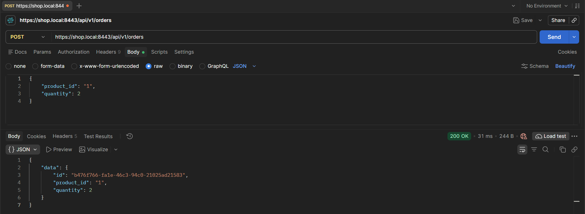

>POST `/orders`

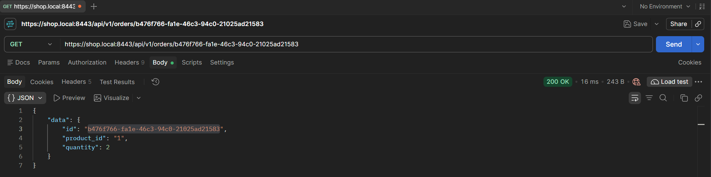

>GET `/orders/:id`

## Network Policies L3/4/7

Las políticas de red nos permiten controlar el tráfico de entrada (`ingress`) y de salida (`egress`) de los pods. Cilium amplía las de Kubernetes con sus propios objetos: `CiliumNetworkPolicy`, que actúa sobre un namespace, y `CiliumClusterwideNetworkPolicy`, que actúa a nivel de clúster y también permite proteger los propios nodos.

Quizá lo más interesante es el filtrado en L7. Añadiendo `rules` a una política, Cilium redirige el tráfico a Envoy y lo filtra por contenido, por ejemplo bloqueando un método HTTP que no esté permitido.

Para configurar las políticas vamos a usar el archivo `cnp.yaml`. Este es un fragmento para ver cómo funciona:

```yaml
apiVersion: cilium.io/v2
kind: CiliumNetworkPolicy
metadata:
  name: products-policy
  namespace: default
spec:
  endpointSelector:
    matchLabels:
      app: products
  ingress:
    - fromEndpoints:
        - matchLabels:
            app: orders
      toPorts:
        - ports:
            - port: "8077"   # gRPC
              protocol: TCP
          rules:
            http:
              - method: "POST"
                path: "/products.ProductService/GetProductById"
    - fromEndpoints:
        - matchLabels:
            app: apigw
      toPorts:
        - ports:
            - port: "8081"   # REST
              protocol: TCP
          rules:
            http:
              - method: "GET"
                path: "/products"
              - method: "GET"
                path: "/products/[0-9]+"
```

>Para la API, que es el punto de entrada, tenemos que permitir el tráfico desde ``ingress`` (el Gateway) usando `fromEntities`.

Esta es la política del micro de `products`. Desde `orders` permitimos el tráfico al puerto `8077`, donde corre el servidor gRPC, y desde `apigw` al `8081`, donde escucha el servidor REST.

Después definimos qué se puede hacer en cada puerto. `orders` solo llama a `GetProductById`, así que es el único método gRPC que dejamos pasar (gRPC va sobre HTTP/2, por eso se filtra como un `POST` a la ruta `/paquete.Servicio/Método`). `apigw` consulta tanto la lista de productos como un producto concreto, así que permitimos `GET /products` y `GET /products/{id}`.

Lo mismo se repite en los otros dos micros. En cuanto una política selecciona un pod para `ingress`, todo lo que no esté permitido explícitamente se descarta. Así bloqueamos el tráfico no previsto, lo que reduce la superficie de ataque y limita el movimiento lateral si algún pod se ve comprometido.

Para probarlo, lanzamos un contenedor efímero dentro del pod de `orders` y desde ahí llamamos a dos métodos: `GetProductById`, que está permitido en la política, y `GetProducts`, que no lo está y por tanto debería ser rechazado (`Access denied`), como vemos en las siguientes imágenes.

```bash
kubectl debug -it orders-cb899cffd-6qcbr --image=curlimages/curl --target=orders-svc --profile=general -- sh
```

>Podéis probarlo cambiando el nombre por el de vuestro pod. `target` es el nombre del contenedor dentro del pod, tal como se define en el manifiesto del Deployment.

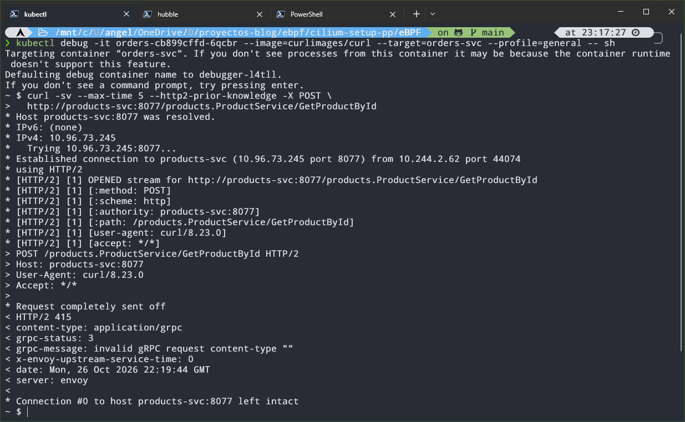

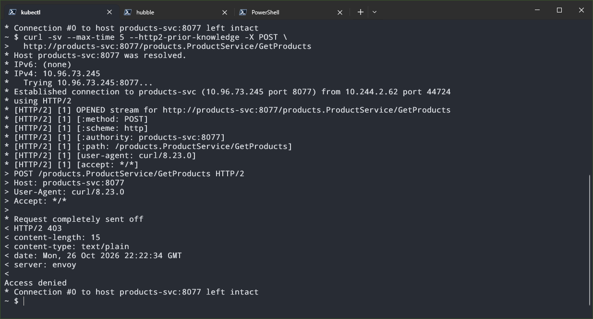

Como veis, ejecutamos un `curl` pero para gRPC. A diferencia de REST, gRPC usa siempre `POST` como método, y la URL lleva directamente la ruta del método gRPC: `/products.ProductService/GetProductById`. Como no usamos TLS, no hay negociación posible, así que con `--http2-prior-knowledge` le decimos a `curl` que hable HTTP/2 directamente.

```bash
curl -sv --max-time 5 --http2-prior-knowledge -X POST \
  http://products-svc:8077/products.ProductService/GetProductById
```

Ojo, que esto no es un cliente gRPC de verdad. No mandamos el cuerpo en el formato de gRPC, así que no esperéis ver los productos. Lo que nos interesa es la respuesta: en `GetProductById` la petición llega al servidor y nos devuelve un `415` ya que el tipo de contenido no es soportado, y en `GetProducts` la corta la política con un `403`.

Esto también lo podemos ver con Hubble, que nos muestra las peticiones rechazadas por la política (más adelante explicaremos cómo funciona la herramienta).

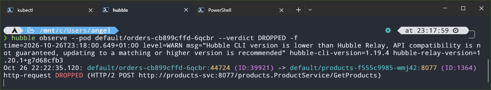

Ahora probamos lo contrario: un `curl` a `products` desde un pod temporal al que ninguna regla da acceso. Aquí no hay respuesta de rechazo como antes, porque Cilium descarta los paquetes y `curl` se queda esperando hasta que salta el timeout:

```bash
kubectl run tmp --rm -it --image=curlimages/curl --restart=Never -- \
  curl -sv --max-time 5 http://products-svc:8081/products
```


Fijaos en la diferencia. Cuando la política deniega a nivel L7 recibimos una respuesta (`Access denied`), mientras que cuando el origen no está autorizado en absoluto (L3/L4) los paquetes se descartan y no recibimos nada, solo el timeout (`curl` sale con el código `28`).

## Agentes eBPF

Como hemos dicho, Cilium se apoya en eBPF (*extended Berkeley Packet Filter*), pero eBPF no es solo cosa de Cilium, nosotros también podemos escribir nuestros propios programas. Un programa eBPF suele tener dos partes:

- **Kernel space:** el programa que se ejecuta dentro del kernel. Define la función, el punto al que se engancha y las estructuras de datos (*maps*). Se suele escribir en C (restringido) y se compila a *bytecode* eBPF, aunque también se puede hacer en Rust. Antes de cargarlo, el verificador que vimos antes comprueba que es seguro.
- **User space:** un proceso normal que carga el programa en el kernel y lee o escribe en los mapas para recuperar la información y procesarla. Aquí hay más libertad de lenguaje (Go, C, Rust, Python...).

Para nuestro ejemplo escribiremos el kernel space en C y el user space en Go, con la librería `cilium/ebpf`. Como recordaréis, vamos a crear dos agentes: el primero genera métricas a partir de la latencia de las conexiones TCP, y el segundo bloquea comandos en ciertos pods. Son las dos caras de la misma moneda: observabilidad y seguridad.

### Agente de métricas: latencia de las conexiones TCP

Para este agente usamos el tracepoint `sock:inet_sock_set_state`, que se dispara cada vez que cambia el estado de un socket TCP. Medimos, desde el lado del cliente, el tiempo que pasa desde que se envía el `SYN` (`SYN_SENT`) hasta que se completa el handshake (`ESTABLISHED`).

> Un tracepoint es un punto de instrumentación que los desarrolladores del kernel han dejado de forma explícita en su código, y suele ser más estable entre versiones que enganchar funciones internas.

En el kernel space usamos tres estructuras:

- Un **LRU hash** (*least recently used*) para guardar temporalmente el timestamp del inicio de cada conexión. Si se llena, descarta las entradas menos usadas, así que no crece sin control.
- Un **per-CPU array**, que mantiene una copia independiente por CPU y evita bloqueos al incrementar. Guarda tres contadores de eventos perdidos, cada uno con un motivo distinto.
- Un **ring buffer**, por el que mandamos al user space los eventos con toda la información necesaria para generar los logs y las métricas.

Los timestamps los obtenemos con `bpf_ktime_get_ns()`, que devuelve los nanosegundos transcurridos desde que arrancó el sistema.

```c
struct {
    __uint(type, BPF_MAP_TYPE_LRU_HASH);
    __uint(max_entries, 16384);
    __type(key, __u64);   // socket mem addr
    __type(value, __u64); // timestamp
} connections SEC(".maps");

// ring buffer para mandar la info de los logs
struct {
    __uint(type, BPF_MAP_TYPE_RINGBUF);
    __uint(max_entries, 1 << 24);
} events SEC(".maps");

// per-CPU array para los eventos perdidos
struct {
    __uint(type, BPF_MAP_TYPE_PERCPU_ARRAY);
    __uint(max_entries, ERRORS_COUNT);
    __type(key, __u32);
    __type(value, __u64);
} lost_events SEC(".maps");

SEC("tracepoint/sock/inet_sock_set_state")
int handle_tcp_state(struct trace_event_raw_inet_sock_set_state *ctx) {

    if (ctx->protocol != IPPROTO_TCP || ctx->family != AF_INET)
        return 0;

    __u64 skaddr = (__u64)ctx->skaddr;
    __u32 key;
    __u64 *val;

    if (ctx->newstate == TCP_SYN_SENT) {
        __u64 ts = bpf_ktime_get_ns();
        bpf_map_update_elem(&connections, &skaddr, &ts, BPF_ANY);

    } else if (ctx->newstate == TCP_ESTABLISHED && ctx->oldstate == TCP_SYN_SENT) {
        __u64 *ts = bpf_map_lookup_elem(&connections, &skaddr);

        if (!ts) {
            bpf_map_delete_elem(&connections, &skaddr);

            key = MISSING_TIMESTAMP;
            val = bpf_map_lookup_elem(&lost_events, &key);
            if (val)
                (*val)++;

            return 0;
        }

        struct tcp_event *ev = bpf_ringbuf_reserve(&events, sizeof(*ev), 0);

        if (!ev) {
            bpf_map_delete_elem(&connections, &skaddr);

            key = RINGBUF_FULL;
            val = bpf_map_lookup_elem(&lost_events, &key);
            if (val)
                (*val)++;

            return 0;
        }

        ev->latency_ns = bpf_ktime_get_ns() - (*ts);
        bpf_map_delete_elem(&connections, &skaddr);
        ev->src_port = ctx->sport;
        ev->dst_port = ctx->dport;
        __builtin_memcpy(ev->saddr, ctx->saddr, 4);
        __builtin_memcpy(ev->daddr, ctx->daddr, 4);
        bpf_ringbuf_submit(ev, 0);

    } else if (ctx->newstate == TCP_CLOSE && ctx->oldstate == TCP_SYN_SENT) {
        bpf_map_delete_elem(&connections, &skaddr);

        key = TCP_FAILED;
        val = bpf_map_lookup_elem(&lost_events, &key);

        if (val)
            (*val)++;
    }

    return 0;
}
```

La lógica es la siguiente: en `SYN_SENT` guardamos el timestamp, y al llegar a `ESTABLISHED` lo recuperamos, calculamos la diferencia y mandamos el evento por el ring buffer. Solo contemplamos IPv4 (`AF_INET`).

Los tres contadores del per-CPU array cubren estos casos:

- **`MISSING_TIMESTAMP`:** la conexión se establece pero no encontramos su timestamp (por ejemplo, porque la entrada se descartó del LRU). Es un problema interno del agente.
- **`RINGBUF_FULL`:** no hay hueco en el ring buffer para el evento. También es interno.
- **`TCP_FAILED`:** el socket pasa de `SYN_SENT` a `CLOSE`, es decir, el intento de conexión ha fallado (rechazada, timeout...).

Para el *user space* usamos **`bpf2go`**, una herramienta de `cilium/ebpf` que compila nuestro código C a bytecode eBPF utilizando Clang y genera los archivos Go necesarios para cargar los programas y mapas desde Go.

Para automatizar este proceso, creamos un archivo `gen.go` que contiene una directiva `//go:generate`, en la que indicamos el objetivo de compilación y el archivo C que queremos compilar. Una vez definido el archivo, ejecutamos `go generate .` desde el directorio del paquete:

```go
package main

//go:generate go tool bpf2go -target bpfel bpf ../../bpf/metrics.bpf.c
```

> Aquí indicamos el objetivo de compilación (`bpfel`, que especifica bytecode BPF *little-endian*), el nombre base de los archivos generados (`bpf`) y el archivo C que queremos compilar.

En el `main.go` definimos un histograma con unos buckets ajustados a las latencias que observamos, y un *collector* propio que recoge los valores del per-CPU array y suma el total de todas las CPUs. En el `main` adjuntamos el programa al tracepoint, lanzamos una goroutine con un bucle infinito que lee los eventos del ring buffer, registra la latencia en el histograma y genera un log, y por último exponemos `/metrics` en el puerto `2112` (el que usan los ejemplos de la librería de Prometheus para Go).

> Los buckets del código ya son los ajustados, que explico tras las pruebas.

```go
...

func newMetrics(reg prometheus.Registerer, lost *ebpf.Map) *metrics {
  m := &metrics{
    latencyHistogram: promauto.With(reg).NewHistogram(prometheus.HistogramOpts{
      Name: "ebpf_tcp_connection_duration",
      Help: "The latency of TCP connection establishment.",
      Buckets: []float64{
        0.00002, 0.00004, 0.00008, 0.00016, 0.00032, 0.00064,
        0.0015, 0.005, 0.025,
        0.25, 1, 3,
      },
    }),
  }
  reg.MustRegister(newLostEventsCollector(lost))
  return m
}

...

func (lec *lostEventsCollector) Collect(ch chan<- prometheus.Metric) {
  for i, reason := range lostReasons {
    var perCPU []uint64
    if err := lec.m.Lookup(uint32(i), &perCPU); err != nil {
      log.Printf("reading %s counter: %v", reason, err)
      continue
    }

    var total uint64
    for _, v := range perCPU {
      total += v
    }

    ch <- prometheus.MustNewConstMetric(
      lec.desc, prometheus.CounterValue, float64(total), reason,
    )
  }
}

func main() {

  ...

  tp, err := link.Tracepoint("sock", "inet_sock_set_state", objs.HandleTcpState, nil)
  if err != nil {
    log.Fatalf("opening tracepoint: %s", err)
  }
  defer tp.Close()

  ...

  go func() {
    var event TCPEvent

    for {
      record, err := rd.Read()
      if err != nil {
        if errors.Is(err, ringbuf.ErrClosed) {
          log.Println("Received signal, exiting..")
          return
        }
        log.Printf("reading from reader: %s", err)
        continue
      }

      if err := binary.Read(bytes.NewBuffer(record.RawSample), binary.LittleEndian, &event); err != nil {
        log.Printf("parsing ringbuf event: %s", err)
        continue
      }

      srcIP := net.IP(event.Saddr[:])
      dstIP := net.IP(event.Daddr[:])

      log.Printf("TCP %s:%d -> %s:%d | latency=%d ns",
        srcIP, event.SrcPort, dstIP, event.DstPort, event.LatencyNs)

      m.latencyHistogram.Observe(float64(event.LatencyNs) / 1e9)
    }
  }()

  http.Handle("/metrics", promhttp.HandlerFor(reg, promhttp.HandlerOpts{}))
  http.ListenAndServe(":2112", nil)
}
```

#### Probándolo en local

Para probarlo en local antes de crear el DaemonSet, generamos, compilamos y ejecutamos (con `sudo`, porque cargar programas eBPF requiere privilegios):

```bash
go generate ./cmd/metrics && go build -o metrics-agent ./cmd/metrics && sudo ./metrics-agent
```

Con el programa en marcha, en otra terminal comprobamos que se ha cargado:

```bash
sudo bpftool prog list | grep -i handle_tcp_state
```


En la terminal del agente deberían aparecer los logs con la información que mandamos por el ring buffer:


Y para ver las métricas hacemos un `curl` a `/metrics` y buscamos el nombre del histograma y del collector:

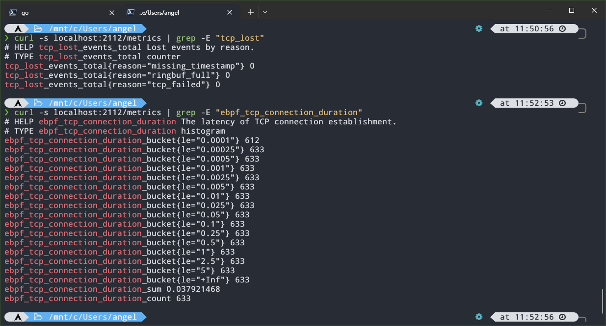

De las 633 conexiones que habían ocurrido hasta ese momento, 612 se resolvieron en menos de 100µs. Con los buckets por defecto casi todas caían en el primero, así que los ajustamos para ganar detalle, y de ahí los valores del código de arriba.

### Agente de seguridad: bloquear comandos con BPF LSM

El segundo agente funciona distinto, en lugar de observar, **actúa**. Para ello usamos **BPF LSM**. LSM (*Linux Security Modules*) es el framework del kernel donde SELinux o AppArmor se enganchan a los *hooks* de seguridad que hay repartidos por el código, y BPF LSM nos permite enganchar ahí programas eBPF. Cada hook se dispara cuando un proceso hace algo delicado, y el programa decide si lo permite (devolviendo `0`) o lo deniega (devolviendo un error negativo, como `-EPERM`).

Nosotros usaremos `bprm_check_security`, que se ejecuta durante el `execve`, justo antes de que el kernel lance el nuevo binario, y nos deja vetar la ejecución.

> Un programa LSM se ejecuta para todos los procesos del host (WSL, Docker, kind...). Por eso solo bloqueamos los binarios que están en la lista de bloqueados y cuya ejecución provenga de un cgroup vigilado. Para el resto, devolvemos `0` y no se entera de nada.

Antes de pasar a la implementación hay que comprobar si tenemos `bpf` activo como LSM en el kernel. En mi caso estaba compilado pero no activo. Podemos verlo con:

```bash
cat /sys/kernel/security/lsm
cat /proc/cmdline
```

El primero muestra los LSM activos (si `bpf` no está al final de la lista, no nos vale, ya que es el que permite ejecutar los programas que estamos creando) y el segundo los parámetros de arranque del kernel. Si el primer archivo no existe, hay que montar antes `securityfs` y volver a comprobar la lista de LSM:

```bash
sudo mount -t securityfs securityfs /sys/kernel/security
```

Como no teníamos `bpf` activo, modificamos (o creamos) el archivo `%UserProfile%\.wslconfig`, añadiendo:

```ini
[wsl2]
kernelCommandLine = lsm=landlock,yama,safesetid,selinux,bpf
```

> Ojo: `lsm=` sustituye a la lista por defecto del kernel, no se suma a ella. Yo usé esa porque es la que me salía de `cat /sys/kernel/security/lsm`, pero la tuya puede ser distinta: copia la que te salga a ti y añade `bpf` al final.

Para que el cambio surta efecto, reiniciamos WSL desde PowerShell:

```powershell
wsl --shutdown
```

Y al volver a abrirlo, comprobamos que la lista de LSM termina en `bpf`.

Volviendo a nuestro agente, usamos dos mapas para filtrar: uno con los paths de los binarios que queremos bloquear y otro con los cgroups que vigilamos. Un cgroup es un mecanismo de Linux que agrupa procesos para limitar y contabilizar sus recursos, y es lo que usan los contenedores. El runtime crea uno por contenedor, así que el ID del cgroup nos sirve para identificar de qué pod viene un proceso. Por último, igual que en el agente de métricas, usamos un ring buffer para mandar al user space quién ha ejecutado qué.

```c
struct {
    __uint(type, BPF_MAP_TYPE_HASH);
    __uint(max_entries, 16384);
    __type(key, __u8[64]); // binary path
    __type(value, __u8);
} blocked_paths SEC(".maps");

struct {
    __uint(type, BPF_MAP_TYPE_HASH);
    __uint(max_entries, 16384);
    __type(key, __u64); // cgroup id
    __type(value, __u8);
} watched_cgroups SEC(".maps");

struct {
    __uint(type, BPF_MAP_TYPE_RINGBUF);
    __uint(max_entries, 1 << 24);
} events SEC(".maps");

SEC("lsm/bprm_check_security")
int BPF_PROG(audit_exec, struct linux_binprm *bprm) {
    __u64 cgi = bpf_get_current_cgroup_id();

    if (!bpf_map_lookup_elem(&watched_cgroups, &cgi))
        return 0;

    __u8 key[64] = {};
    bpf_probe_read_kernel_str(key, sizeof(key), bprm->filename);

    if (!bpf_map_lookup_elem(&blocked_paths, &key))
        return 0;

    struct event *ev = bpf_ringbuf_reserve(&events, sizeof(*ev), 0);

    if (ev) {
        ev->timestamp_ns = bpf_ktime_get_ns();
        ev->pid = bpf_get_current_pid_tgid() >> 32;
        ev->cgroup_id = cgi;
        __builtin_memcpy(ev->path, key, sizeof(key));
        bpf_get_current_comm(&ev->comm, sizeof(ev->comm));
        bpf_ringbuf_submit(ev, 0);
    }

    return -EPERM;
}
```

> Si devolvemos `-EPERM`, `execve` falla con `Operation not permitted`.

Un par de detalles del código. La clave del mapa de paths es un array de 64 bytes, y por eso inicializamos `key` a ceros: el mapa compara los 64 bytes enteros, y así lo que sobra tras el path no mete basura. Además, la comparación es **por texto**, así que `/bin/cat` y `/usr/bin/cat` son dos entradas distintas, y lo veremos en las pruebas.

Del lado del user space, igual que en el agente de métricas, exponemos `/metrics` en el puerto `2112` y leemos el ring buffer en una goroutine. La única métrica es un contador con las ejecuciones bloqueadas. Como el agente corre dentro del clúster (en un DaemonSet), configuramos el cliente de Kubernetes con `InClusterConfig()`. Los comandos a bloquear los he dejado en una variable, aunque se podrían pasar por variables de entorno o un ConfigMap.

Para decidir qué cgroups vigilar usamos dos funciones auxiliares:

- **`findCgroupID`**: recibe el ID del contenedor, busca bajo `/sys/fs/cgroup` el directorio de su cgroup y devuelve su inodo, que coincide con el id que ve el kernel.
- **`syncCgroups`**: lista los pods con la etiqueta `ebpf-sec=enforce` (que añadimos a los Deployments de los micros para probar), extrae el ID de cada contenedor, llama a `findCgroupID` y, si lo encuentra, lo inserta en el mapa eBPF.

>Al igual que en el agente de métricas, usamos un `gen.go` para generar el código Go con el que cargamos el programa y sus mapas.

```go
func newMetrics(reg prometheus.Registerer) *metrics {
  m := &metrics{
    execsCounter: promauto.With(reg).NewCounter(prometheus.CounterOpts{
      Name: "ebpf_blocked_execs_total",
      Help: "Total number of command executions blocked by the BPF LSM program.",
    }),
  }
  return m
}

func syncCgroups(ctx context.Context, cs kubernetes.Interface, m *ebpf.Map) error {
  pods, err := cs.CoreV1().Pods("").List(ctx, metav1.ListOptions{
    LabelSelector: "ebpf-sec=enforce",
  })
  if err != nil {
    return err
  }
  for _, pod := range pods.Items {
    for _, c := range pod.Status.ContainerStatuses {
      _, id, ok := strings.Cut(c.ContainerID, "://")
      if !ok || id == "" {
        continue
      }
      cgID, err := findCgroupID(id)
      if err != nil {
        log.Printf("%s/%s: %v", pod.Namespace, pod.Name, err)
        continue
      }
      if err := m.Put(cgID, uint8(1)); err != nil {
        return err
      }
      log.Printf("vigilando %s/%s cgroup=%d", pod.Namespace, pod.Name, cgID)
    }
  }
  return nil
}

func findCgroupID(containerID string) (uint64, error) {
  root := "/sys/fs/cgroup"

  var cgroupID uint64
  found := false

  err := filepath.WalkDir(root,
    func(path string, d os.DirEntry, err error) error {
      if err != nil {
        return nil
      }
      if !d.IsDir() || !strings.Contains(path, containerID) {
        return nil
      }

      var stat unix.Stat_t
      if err := unix.Stat(path, &stat); err != nil {
        return nil
      }

      cgroupID = stat.Ino
      found = true
      return filepath.SkipAll
    })

  if err != nil {
    return 0, err
  }
  if !found {
    return 0, fmt.Errorf("cgroup not found for container %s", containerID)
  }

  return cgroupID, nil
}

...

func main() {
  ctx := context.Background()

  cfg, err := rest.InClusterConfig()
  if err != nil {
    log.Fatalf("loading in-cluster config: %v", err)
  }
  cs, err := kubernetes.NewForConfig(cfg)
  if err != nil {
    log.Fatalf("creating kubernetes client: %v", err)
  }

  ...

  // insertamos en el mapa los paths de los comandos que queremos bloquear
  var paths = []string{"/bin/curl", "/bin/cat"}

  for _, p := range paths {
    var key [64]byte
    copy(key[:], p)
    if err := objs.BlockedPaths.Put(&key, uint8(1)); err != nil {
      log.Fatalf("copying command to blocked_paths ebpf map: %v", err)
    }
  }

  if err := syncCgroups(ctx, cs, objs.WatchedCgroups); err != nil {
    log.Println(err)
  }

  lsm, err := link.AttachLSM(link.LSMOptions{
    Program: objs.AuditExec,
  })
  if err != nil {
    log.Fatalf("opening lsm hook: %s", err)
  }
  defer lsm.Close()

  // los pods aparecen y desaparecen, así que resincronizamos cada 10 segundos
  go func() {
    for {
      time.Sleep(10 * time.Second)
      if err := syncCgroups(ctx, cs, objs.WatchedCgroups); err != nil {
        log.Println(err)
      }
    }
  }()

  ...

  http.Handle("/metrics", promhttp.HandlerFor(reg, promhttp.HandlerOpts{}))
  http.ListenAndServe(":2112", nil)
}
```

#### Probándolo en local

Para probarlo fuera del clúster hacemos unos ajustes; comentamos en el `main` todo lo relacionado con el cliente de Kubernetes (ya que no lo desplegamos como un DaemonSet) y añadimos un flag para pasar la ruta de un cgroup de pruebas, cuyo id insertamos en el mapa del kernel. Se podría hardcodear, pero así es más cómodo.

```go
cgroupPath := flag.String("cgroup", "", "ruta de un cgroup a vigilar (pruebas)")
flag.Parse()

if *cgroupPath != "" {
  var st unix.Stat_t
  if err := unix.Stat(*cgroupPath, &st); err != nil {
    log.Fatal(err)
  }
  if err := objs.WatchedCgroups.Put(uint64(st.Ino), uint8(1)); err != nil {
    log.Fatal(err)
  }
  log.Printf("vigilando cgroup %d (%s)", st.Ino, *cgroupPath)
}
```

Los comandos a bloquear cambian. En la máquina local los binarios están en `/usr/bin`, mientras que en las imágenes de los micros están en `/bin`. Como ejemplo bloqueamos `curl` y `cat`:

```go
var paths = []string{"/usr/bin/curl", "/usr/bin/cat"}
```

> Podemos ver el path de un comando con `type <comando>` en la terminal de pruebas.

Ahora creamos el cgroup y lanzamos una shell dentro de él, desde la que ejecutaremos los comandos de prueba:

```bash
sudo mkdir /sys/fs/cgroup/prueba
sudo sh -c 'echo $$ > /sys/fs/cgroup/prueba/cgroup.procs; exec bash'
```

> Esto crea el cgroup `prueba`, mete el PID de la shell en su `cgroup.procs` (así la shell pasa a pertenecer al cgroup) y la sustituye por `bash`. Todo lo que ejecutemos desde ahí hereda el cgroup.

En otra terminal compilamos y lanzamos el agente apuntando a ese cgroup:

```bash
sudo ./security-agent -cgroup /sys/fs/cgroup/prueba
```

Si ahora ejecutamos `cat` o `curl` desde la shell del cgroup, nos los deniega:

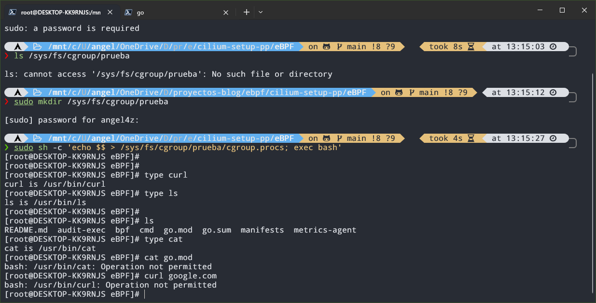

Mientras tanto, el agente registra en los logs el cgroup vigilado y los comandos bloqueados:

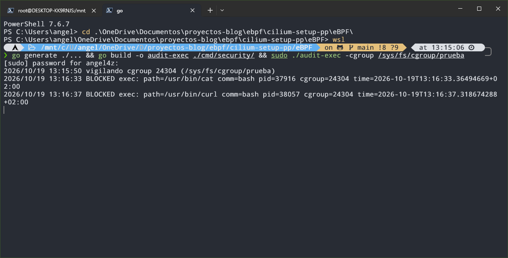

Y si en otra terminal consultamos `/metrics`, veremos el contador de ejecuciones bloqueadas:


Al terminar, salimos de la shell de pruebas y borramos el cgroup con `sudo rmdir /sys/fs/cgroup/prueba`.

### Desplegando los agentes en el clúster

Igual que con los microservicios, construimos las imágenes y las cargamos en kind:

```bash
docker build -f cmd/metrics/Dockerfile -t azuar4e/ebpf-metrics:v1 .
docker build -f cmd/security/Dockerfile -t azuar4e/ebpf-sec:v1 .
kind load docker-image azuar4e/ebpf-sec:v1 azuar4e/ebpf-metrics:v1 --name kind
```

Antes de construir la imagen del agente de seguridad, acordaos de volver a poner los paths de las imágenes de los micros (`/bin/curl` y `/bin/cat`).

Con las imágenes cargadas, desplegamos los DaemonSet, que crean un pod de cada agente por nodo. Al tener tres workers, tendremos tres pods de cada uno:

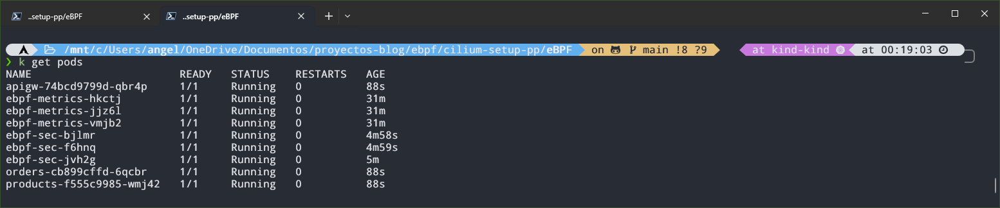

El agente de seguridad necesita además permisos para listar pods, porque si no usará el service account `default` y el clúster le denegará la petición. Por eso creamos un `ServiceAccount`, un `ClusterRole` con permisos de lectura sobre `pods` y un `ClusterRoleBinding` que los une.

Para comprobar que el agente de métricas funciona, lo más fácil es hacer un port-forward a uno de sus pods y un `curl` a `/metrics`:

```bash
kubectl port-forward pod/ebpf-metrics-hkctj 2112:2112
```

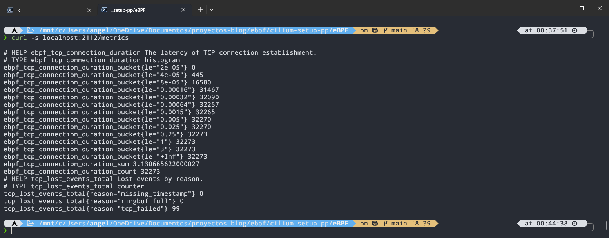

Para el agente de seguridad tenemos que añadir la etiqueta `ebpf-sec: enforce` en `spec.template.metadata.labels` de los Deployment de los micros (las etiquetas de los pods que se crean), de modo que se recreen con ella. En los logs de cada pod del agente vemos esto:


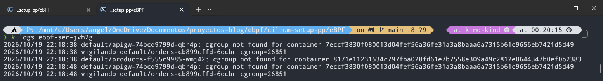

Cada pod del DaemonSet solo encuentra en su `/sys/fs/cgroup` los cgroups de los contenedores de su propio nodo. Como los micros corren cada uno en un nodo distinto (en mi caso, por decisión del scheduler de Kubernetes), cada pod del agente acaba vigilando un micro diferente.

Si ahora intentamos ejecutar un comando bloqueado dentro de uno de los micros, nos lo deniega:

```bash
kubectl exec -it <pod-micro> -- cat /etc/hostname
```


Para ver las métricas repetimos el proceso anterior con el pod del agente de seguridad:

```bash
kubectl port-forward pod/ebpf-sec-bjlmr 2112:2112
```

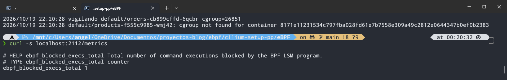

> Nótese que el port-forward lo he hecho al pod que vigila el cgroup del `apigw`, que es donde he ejecutado el comando. Si miráis las métricas de otro pod en el que no hemos ejecutado nada, el contador seguirá a 0.

## Observabilidad

Anteriormente hemos mostrado cómo habilitar el endpoint `/metrics` para que Prometheus pueda leerlo, y también cómo activar Hubble. Ahora vamos a unir todas las piezas del puzle para completar la infraestructura de observabilidad.

Lo primero será instalar tanto Prometheus como Grafana. Para ello vamos a usar los [helm charts de la comunidad](https://artifacthub.io/packages/helm/prometheus-community/kube-prometheus-stack):

```bash
helm repo add prometheus-community https://prometheus-community.github.io/helm-charts
helm repo update
helm install kps prometheus-community/kube-prometheus-stack -n monitoring --create-namespace
```

> Con el último comando, primero creamos el namespace `monitoring`, que hasta ahora no existía, y segundo, instalamos el stack de Prometheus con el nombre `kps`.

El chart de Helm que acabamos de instalar, entre otras cosas, contiene lo siguiente:

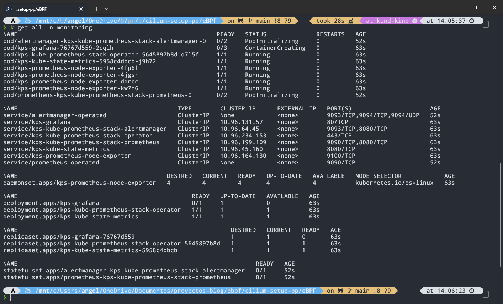

- **Prometheus**, junto con su **operator**, que añade objetos propios como el `PodMonitor` o el `ServiceMonitor` para indicarle qué debe scrapear.
- **Grafana**, que ya viene conectado a Prometheus y trae dashboards precargados a través de ConfigMaps.
- **Alertmanager**, para gestionar las alertas.
- **`node-exporter`** (un pod por nodo, como DaemonSet) y **`kube-state-metrics`**, que exportan métricas de los nodos y del estado de los objetos de Kubernetes, respectivamente.

Para que Prometheus pueda leer las métricas de los agentes eBPF que hemos creado, tenemos que declarar un `PodMonitor`. Junto con el `ServiceMonitor`, es una CRD (Custom Resource Definition) que añade el Prometheus Operator, incluido en el helm chart, y sirve para indicarle a Prometheus qué endpoints debe scrapear. El `ServiceMonitor` descubre los destinos a través de un Service, mientras que el `PodMonitor` selecciona los pods directamente, que es lo que necesitamos en nuestro caso, ya que nuestros agentes corren como DaemonSet y no tienen Service.

```yaml
apiVersion: monitoring.coreos.com/v1
kind: PodMonitor
metadata:
  name: ebpf-agents
  namespace: monitoring
  labels:
    release: kps
spec:
  namespaceSelector:
    matchNames: [default]
  selector:
    matchExpressions:
      - {key: app, operator: In, values: [ebpf-metrics, ebpf-sec]}
  podMetricsEndpoints:
    - port: metrics
      path: /metrics
```

Como tenemos dos agentes, usamos `matchExpressions`, aunque también podríamos crear dos `PodMonitor` y usar simplemente `matchLabels`. Por otro lado, lanzamos el recurso en el namespace `monitoring` y lo ponemos a buscar en `default` (por defecto busca en el namespace en el que se ha desplegado), y tenemos que especificar el nombre del release de Helm con `release: kps`.

Ahora vamos a montar desde Grafana las gráficas para dar forma a las métricas que hemos generado. Para ver la interfaz de Grafana podemos hacer un port-forward al servicio y meter la URL en el navegador. El usuario es `admin` y, para saber la contraseña, hacemos:

```bash
kubectl get secret -n monitoring kps-grafana -o jsonpath='{.data.admin-password}' | base64 -d
```

Una vez dentro, podemos comprobar si Prometheus lee las métricas dirigiéndonos a `Explore` y, con la fuente de datos de Prometheus, buscar las métricas que definimos en el user space.

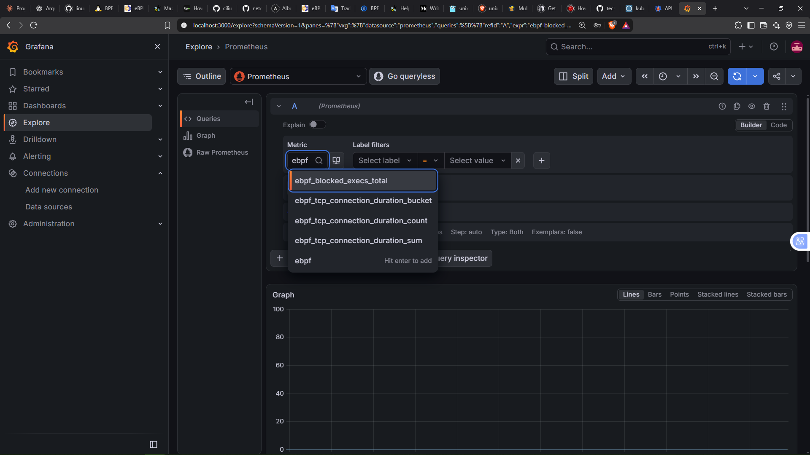

> También podéis buscar la métrica `tcp_lost_events_total` y os aparecerá.

Ahora vamos a construir los gráficos con nuestras métricas para obtener el mayor detalle posible. Para ello nos vamos a la pestaña de Dashboards, creamos uno nuevo y añadimos un panel por cada métrica.

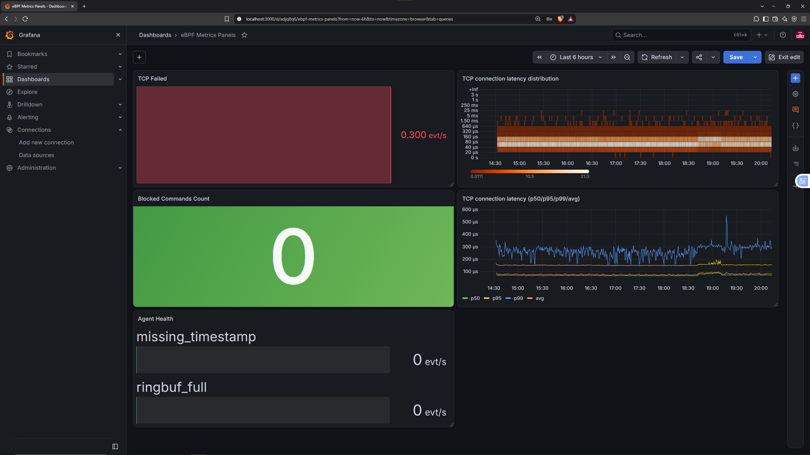

Yo he creado los siguientes paneles:

- **TCP lost connections** (dos paneles): uno con las conexiones que fallan y otro con los eventos que el propio agente eBPF no ha podido registrar (por ejemplo, porque falta el timestamp o porque el ring buffer está lleno).
- **Latencia de conexión TCP** (dos paneles): a partir del histograma de Prometheus, un *Time series* con los percentiles 50, 95 y 99 junto con la media, y un *Heatmap* con los valores recopilados por los buckets.
- **Comandos bloqueados**: un contador con el total de ejecuciones denegadas por el programa LSM, que, como veis, está a cero porque aún no hemos bloqueado nada.

Para verlo en acción, ejecutamos un bucle dentro del pod de `apigw`, que lleva la etiqueta de vigilancia. Cada `cat` será denegado por el hook LSM:

```bash
kubectl exec -it apigw-74bcd9799d-qbr4p -- sh -c 'for i in $(seq 1 20); do cat /etc/hostname; sleep 1; done'
```

> Esto ejecuta un bucle de 20 iteraciones que lanza un `cat` y espera un segundo, dentro del pod de `apigw`. Como `cat` está en la lista de comandos bloqueados, cada intento falla con `Operation not permitted` y el agente lo contabiliza.

Pasado un momento (por defecto, Prometheus recoge las métricas cada 15 segundos), refrescamos el dashboard y el contador habrá subido:


No nos olvidamos de las métricas de Hubble y Cilium. Para empezar con Hubble, hacemos un port-forward y comprobamos el estado de la conectividad con:

```bash
cilium hubble port-forward &
hubble status
```

Para que Prometheus pueda ver las métricas de Hubble (y las de Cilium que habilitamos al principio del artículo) tenemos que hacer dos cosas: indicar qué métricas de Hubble queremos exportar y crear un `ServiceMonitor` por cada componente. Necesitamos uno para Hubble, otro para el agente de Cilium y otro para el operator, y el propio chart de Cilium los genera con los siguientes parámetros:

```bash
helm upgrade cilium cilium/cilium -n kube-system --reuse-values \
  --set hubble.metrics.enabled="{dns,drop,tcp,flow,http}" \
  --set hubble.metrics.serviceMonitor.enabled=true \
  --set hubble.metrics.serviceMonitor.labels.release=kps \
  --set prometheus.serviceMonitor.enabled=true \
  --set prometheus.serviceMonitor.labels.release=kps \
  --set operator.prometheus.serviceMonitor.enabled=true \
  --set operator.prometheus.serviceMonitor.labels.release=kps
```

> La etiqueta `release=kps` es la que busca el Prometheus del chart para aceptar un monitor, y debe coincidir con el nombre de nuestro release de Helm. Sin ella, Prometheus lo ignora.

Antes de ver las métricas en Grafana, vamos a usar `hubble observe`, que muestra por terminal los eventos individuales (flujos) que Hubble tiene en memoria. Así podréis ver la diferencia con las métricas que hemos generado con eBPF.

Aprovechando las `CiliumNetworkPolicy` que definimos en la sección de [políticas de red](#network-policies-l347), vamos a lanzar un `curl` hacia `products` desde un pod temporal al que ninguna regla autoriza. Esto debería descartar el tráfico y podremos verlo en Hubble.

En una terminal dejamos Hubble escuchando, filtrando solo los paquetes descartados y quitando el ruido del tráfico ICMP:

```bash
hubble observe --verdict DROPPED --not --protocol icmp -f
```

Y en otra lanzamos la petición:

```bash
kubectl run curl-test --rm -it --image=curlimages/curl --restart=Never -- curl -sv --max-time 3 http://10.96.73.245:8081
```

> Esto ejecuta un `curl` a `products` desde un pod temporal. Como ninguna regla permite este tráfico, Cilium descarta los paquetes y `curl` termina por timeout. Yo he usado el `ClusterIP` del servicio de `products`, que en vuestro clúster será distinto.


En la salida vemos el origen y el destino, la identidad de seguridad de Cilium de cada uno, el veredicto (`Policy denied DROPPED`) y los flags TCP. Solo aparece el `SYN`, el primer paquete del handshake, repetido en cada reintento, porque el paquete se descarta y nunca llega a su destino.

Volviendo a las métricas, en Grafana podemos ir a `Explore` para ver si, efectivamente, Prometheus está leyendo bien las métricas.

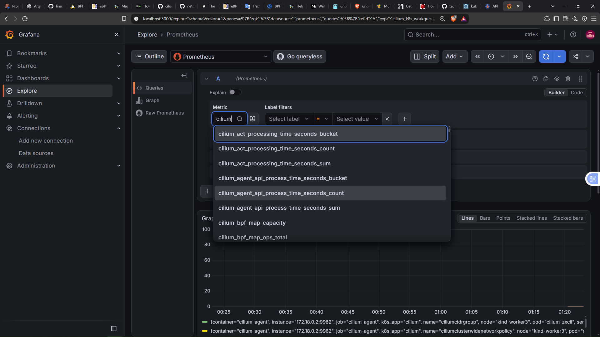

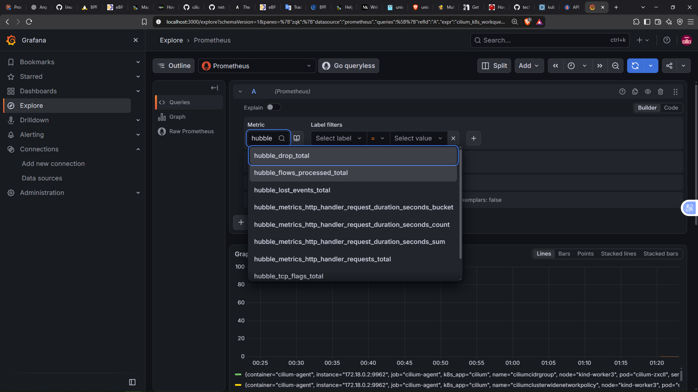

Como se muestra en las capturas, en el buscador aparecen tanto las métricas de Hubble como las de Cilium. Con esto podríamos montar una gran variedad de dashboards, pero eso da para un post aparte.

Como ejemplo, yo he montado un dashboard con tres paneles. En el primero tenemos los paquetes descartados por Hubble (`hubble_drop_total`); en el segundo, los flujos completados (`hubble_flows_processed_total`), con los reenviados en amarillo y los descartados en verde; y en el tercero, todos los errores y advertencias de los pods del agente de Cilium (`cilium_errors_warnings_total`).


> Para generar datos en las gráficas se ha ejecutado el `curl` anterior en bucle.

Recopilar estas métricas es especialmente útil para tener mayor visibilidad y detalle de lo que está ocurriendo en nuestro clúster, e identificar lo que pasa y actuar en consecuencia.

## Notas complementarias

Algunos que estéis más puestos en el tema quizá conozcáis [Tetragon](https://tetragon.io/), una herramienta de código abierto del ecosistema de Cilium enfocada en la observabilidad y la seguridad en tiempo de ejecución. Mediante eBPF, permite monitorizar la actividad de los procesos dentro del clúster y aplicar políticas de seguridad sin necesidad de desarrollar nuestros propios agentes desde cero.

Por ejemplo, podríamos definir una `TracingPolicy` para impedir que ciertos pods ejecuten determinados comandos, cubriendo así buena parte de la funcionalidad de nuestro agente de seguridad. El de observabilidad, en cambio, es otra historia. Nuestra métrica de latencia TCP requiere correlacionar las transiciones de un socket entre `SYN_SENT` y `ESTABLISHED`, calcular la diferencia entre ambos timestamps en el kernel y exportar los resultados como un histograma de Prometheus. Se trata de una lógica personalizada que Tetragon no proporciona directamente mediante sus políticas.

Si conocíais la herramienta, puede que os hayáis preguntado por qué no la usamos. Tetragon es especialmente interesante para aplicar políticas de seguridad en Kubernetes sin tener que desarrollar toda la infraestructura de instrumentación desde cero. En el contexto de este artículo, sin embargo, me parecía más didáctico implementar los agentes manualmente para entender cómo funcionan los programas eBPF por debajo e ilustrar sus posibilidades. Además, hacerlo así nos permite adaptar la lógica exactamente a nuestras necesidades, sin limitarnos a las funcionalidades que ofrece una herramienta existente.

Eso sí, hay que ser realistas; el agente de seguridad es una demo. Bloquea en función del texto de la ruta del ejecutable y no proporciona contexto sobre los procesos. Tetragon ofrece una solución mucho más completa en ese sentido, pero desarrollar nuestro propio agente nos ha permitido explorar directamente los mecanismos que hacen posibles este tipo de herramientas.

## Conclusión

Con esto damos por terminado el artículo. Recordad que podéis encontrar todo el código utilizado en esta publicación, incluidos los manifiestos `.yaml`, en los siguientes enlaces:

- Código de los microservicios (rama `grpc`): <https://github.com/azuar4e/micros-sample/tree/grpc>
- Código de los agentes eBPF: <https://github.com/azuar4e/ebpf-observability-security>

En esencia, hemos aprendido a desplegar y configurar Cilium para que, además de ser el CNI, haga también labores de Service Mesh como el cifrado entre nodos con WireGuard, HTTPS con el exterior mediante la Gateway API de Kubernetes y control del tráfico permitido dentro del clúster con políticas de red. También hemos comparado las diferencias y ventajas entre una implementación REST y otra basada en gRPC.

Y, quizá lo más interesante, hemos programado dos agentes eBPF, utilizando C para el kernel space y Go para el user space. El primero mide la latencia de establecimiento de las conexiones TCP y la expone mediante un histograma de Prometheus; el segundo permite bloquear la ejecución de determinados binarios en los contenedores que seleccionemos, registrando también los intentos denegados como métricas.

Para cerrar el círculo, hemos configurado una pila de observabilidad completa: Hubble para observar los eventos del clúster, Prometheus para recoger las métricas (las de Hubble, las del agente y el operador de Cilium y las de nuestros agentes eBPF) y Grafana, usando Prometheus como fuente de datos, para darles forma en gráficos y dashboards.

Esto no es más que una muestra de todo lo que se puede hacer con Cilium y eBPF, y espero que haya sido útil para entender su relevancia en las infraestructuras modernas.

Gracias por leer, nos vemos en la próxima. ¡Cuidaos! 👋


---

> Autor: [Angel Azuara Eizaguirre](https://www.linkedin.com/in/angel-azuara/)  
> URL: https://azuar4e.github.io/es/posts/cilium/  

